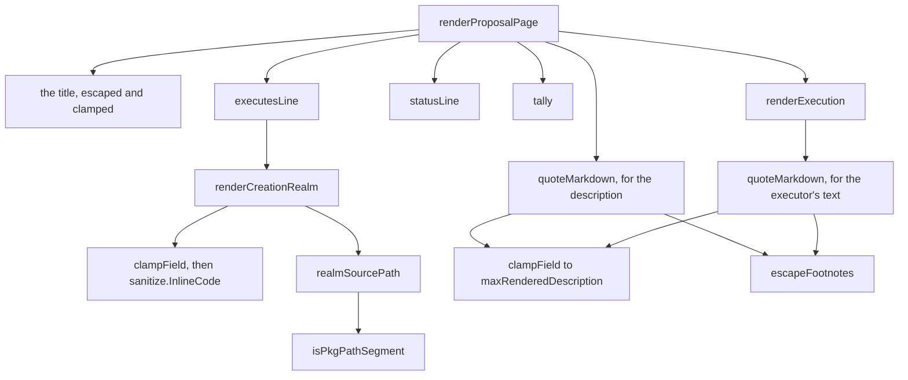

# The proposal page's metadata block, `### Execution`, and a linked creation realm
Written by claude-opus-5-5, high effort.
PR: [gnolang/gno#6149](https://github.com/gnolang/gno/pull/6149)

## TLDR

[`gno.land/r/gov/dao/impl/v0`](https://github.com/gnolang/gno/blob/067ec7c85053b7c9f752a50db99191f794942972/examples/gno.land/r/gov/dao/impl/v0/gnomod.toml#L1)
renders the page a govDAO member votes from. It printed the proposer's
description, the executor's description and the line
`Executor created in: <path>` as three paragraphs with nothing between them,
and that path was plain text a reader had to copy out to find the code.
[`renderProposalPage`](https://github.com/gnolang/gno/blob/067ec7c85053b7c9f752a50db99191f794942972/examples/gno.land/r/gov/dao/impl/v0/render.gno#L121-L142)
now writes five lines of its own first, `Author:`, `Executes:`, `Status:`,
`Eligible:` and `Votes:`, then `### Execution` for the executor's words, a
horizontal rule, then `### Description` for the proposer's.
The `Executes:` value becomes a link to `<path>$source` when
[`realmSourcePath`](https://github.com/gnolang/gno/blob/067ec7c85053b7c9f752a50db99191f794942972/examples/gno.land/r/gov/dao/impl/v0/render.gno#L246-L267)
reads it as a package path this chain serves, so the code is one click away.
[`quoteMarkdown`](https://github.com/gnolang/gno/blob/067ec7c85053b7c9f752a50db99191f794942972/examples/gno.land/r/gov/dao/impl/v0/render.gno#L145-L172)
renders both descriptions inside a quote the page draws, so any block they
open ends with the quote and the rules, headings and action bar outside it
are the page's alone.
`proposalStatus.String` and the `### Stats` list at the foot of the page are
gone, replaced by
[`statusLine`](https://github.com/gnolang/gno/blob/067ec7c85053b7c9f752a50db99191f794942972/examples/gno.land/r/gov/dao/impl/v0/types.gno#L153-L163)
and [`tally`](https://github.com/gnolang/gno/blob/067ec7c85053b7c9f752a50db99191f794942972/examples/gno.land/r/gov/dao/impl/v0/types.gno#L144-L151).

## Before and after

| Place | Before | After, through |
| --- | --- | --- |
| the page head | title, `Author:`, then the proposer's description | title, then five lines the page writes itself, through [`renderProposalPage`](https://github.com/gnolang/gno/blob/067ec7c85053b7c9f752a50db99191f794942972/examples/gno.land/r/gov/dao/impl/v0/render.gno#L123-L129) |
| the realm that runs | `Executor created in:` plus an escaped code span, below both descriptions, and absent when the value stripped to nothing | `Executes:` on the block's second line, always drawn, through [`executesLine`](https://github.com/gnolang/gno/blob/067ec7c85053b7c9f752a50db99191f794942972/examples/gno.land/r/gov/dao/impl/v0/render.gno#L200-L208) |
| a creation realm the grammar accepts | the escaped code span, unlinked | the same span as the text of a link to `<path>$source`, through [`realmSourcePath`](https://github.com/gnolang/gno/blob/067ec7c85053b7c9f752a50db99191f794942972/examples/gno.land/r/gov/dao/impl/v0/render.gno#L246-L267) |
| the executor's description | `This proposal contains the following metadata:` under the proposer's prose | `### Execution` above the rule, clamped and quoted, through [`renderExecution`](https://github.com/gnolang/gno/blob/067ec7c85053b7c9f752a50db99191f794942972/examples/gno.land/r/gov/dao/impl/v0/render.gno#L210-L221) |
| the proposer's description | first on the page, verbatim | `### Description` under the rule, clamped and quoted, through [`quoteMarkdown`](https://github.com/gnolang/gno/blob/067ec7c85053b7c9f752a50db99191f794942972/examples/gno.land/r/gov/dao/impl/v0/render.gno#L136-L138) |
| status and denial reason | `- **PROPOSAL HAS BEEN DENIED**` and a `REASON:` line inside `### Stats` | `Status: REJECTED, <reason>` on the block's third line, through [`statusLine`](https://github.com/gnolang/gno/blob/067ec7c85053b7c9f752a50db99191f794942972/examples/gno.land/r/gov/dao/impl/v0/types.gno#L153-L163) |
| the tally | `- YES PERCENT: 68.42105263157895%` at full float width | `Votes: YES 68.42%`, then NO and ABSTAIN the same way, through [`tally`](https://github.com/gnolang/gno/blob/067ec7c85053b7c9f752a50db99191f794942972/examples/gno.land/r/gov/dao/impl/v0/types.gno#L144-L151) |
| the vote list | `[Detailed voting list]` above the action bar | `[detail]` closing the `Votes:` line, through [`renderProposalPage`](https://github.com/gnolang/gno/blob/067ec7c85053b7c9f752a50db99191f794942972/examples/gno.land/r/gov/dao/impl/v0/render.gno#L129) |
| the text form | its own copy of the metadata lines, with the title and the description raw | the page's helpers, the title escaped and the description quoted, through [`StringifyProposal`](https://github.com/gnolang/gno/blob/067ec7c85053b7c9f752a50db99191f794942972/examples/gno.land/r/gov/dao/impl/v0/types.gno#L205-L223) |

Before, the page down to its action bar, from the golden this branch rewrote,
read at its base:

```markdown
## Prop #0 - Test
Author: g1jg8mtutu9khhfwc4nxmuhcpftf0pajdhfvsqf5

This proposal always pass on execution

Executor created in: `gno.land/r/test/govdao`


---

### Stats
- **Proposal is open for votes**
- Tiers eligible to vote: T1, T2, T3
- YES PERCENT: 0%
- NO PERCENT: 0%
- ABSTAIN PERCENT: 0%

[Detailed voting list](/r/gov/dao/impl/v0:0/votes)

---
```

After, the same stretch of the same proposal, from
[`govdao_execute_proposal_01_filetest.gno`](https://github.com/gnolang/gno/blob/067ec7c85053b7c9f752a50db99191f794942972/examples/gno.land/r/gov/dao/impl/v0/filetests/govdao_execute_proposal_01_filetest.gno#L64-L77):

```markdown
## Prop #0 - Test
Author: g1jg8mtutu9khhfwc4nxmuhcpftf0pajdhfvsqf5\
Executes: [`gno.land/r/test/govdao`](/r/test/govdao$source)\
Status: ACTIVE\
Eligible: T1, T2, T3\
Votes: YES 0.00%, NO 0.00%, ABSTAIN 0.00% ([detail](/r/gov/dao/impl/v0:0/votes))

---

### Description

  > This proposal always pass on execution

---
```

The first four lines end in `\`, the markdown hard break, because a plain
newline would fold the block into
[one paragraph](https://github.com/gnolang/gno/blob/067ec7c85053b7c9f752a50db99191f794942972/examples/gno.land/r/gov/dao/impl/v0/render.gno#L121-L122).
The description line opens on `  > `, the quote this branch draws around
whatever the proposer wrote.

## How the page is assembled

The after, as a call tree under
[`renderProposalPage`](https://github.com/gnolang/gno/blob/067ec7c85053b7c9f752a50db99191f794942972/examples/gno.land/r/gov/dao/impl/v0/render.gno#L96-L143),
in the order the page is written:



- [`renderProposalPage`](https://github.com/gnolang/gno/blob/067ec7c85053b7c9f752a50db99191f794942972/examples/gno.land/r/gov/dao/impl/v0/render.gno#L121-L142)
  decides the order, and the order is the security half of the change: the
  title above the block is escaped and folded to one line, so nothing the
  proposer wrote can render as structure higher up the page.
- [`executesLine`](https://github.com/gnolang/gno/blob/067ec7c85053b7c9f752a50db99191f794942972/examples/gno.land/r/gov/dao/impl/v0/render.gno#L200-L208)
  decides whether the line names a realm or reads `none reported`. It never
  drops the line, since a missing line reads as a shorter page rather than as
  a disclosure nobody made.
- [`renderCreationRealm`](https://github.com/gnolang/gno/blob/067ec7c85053b7c9f752a50db99191f794942972/examples/gno.land/r/gov/dao/impl/v0/render.gno#L223-L244)
  decides the order of the three passes over the value: clamp to
  [`maxRenderedRealm`](https://github.com/gnolang/gno/blob/067ec7c85053b7c9f752a50db99191f794942972/examples/gno.land/r/gov/dao/impl/v0/clamp.gno#L33),
  escape with
  [`sanitize.InlineCode`](https://github.com/gnolang/gno/blob/067ec7c85053b7c9f752a50db99191f794942972/examples/gno.land/p/nt/markdown/sanitize/v0/sanitize.gno#L1430),
  then wrap in a link. Cutting after escaping can slice the closing fence off
  the code span, which
  [clamp.gno](https://github.com/gnolang/gno/blob/067ec7c85053b7c9f752a50db99191f794942972/examples/gno.land/r/gov/dao/impl/v0/clamp.gno#L69-L75)
  states and the enormous-value case of the disclosure filetest asserts.
- [`realmSourcePath`](https://github.com/gnolang/gno/blob/067ec7c85053b7c9f752a50db99191f794942972/examples/gno.land/r/gov/dao/impl/v0/render.gno#L246-L267)
  decides the destination: the chain domain matched whole against
  [`runtime.ChainDomain()`](https://github.com/gnolang/gno/blob/067ec7c85053b7c9f752a50db99191f794942972/gnovm/stdlibs/chain/runtime/native.gno#L10),
  a letter directory of `r` or `p`, then one or more accepted segments, giving
  the root-relative path plus `$source`.
- [`isPkgPathSegment`](https://github.com/gnolang/gno/blob/067ec7c85053b7c9f752a50db99191f794942972/examples/gno.land/r/gov/dao/impl/v0/render.gno#L269-L293)
  decides which segments count, mirroring
  [`Re_name`](https://github.com/gnolang/gno/blob/067ec7c85053b7c9f752a50db99191f794942972/gnovm/pkg/gnolang/mempackage.go#L70),
  the grammar the VM enforces on a deployed path: a leading lowercase letter,
  an alphanumeric body, single `_` or `-` separators, never doubled and never
  at the end.
- [`quoteMarkdown`](https://github.com/gnolang/gno/blob/067ec7c85053b7c9f752a50db99191f794942972/examples/gno.land/r/gov/dao/impl/v0/render.gno#L153-L172)
  decides what a description looks like on the page. It
  [clamps](https://github.com/gnolang/gno/blob/067ec7c85053b7c9f752a50db99191f794942972/examples/gno.land/r/gov/dao/impl/v0/render.gno#L154)
  to
  [`maxRenderedDescription`](https://github.com/gnolang/gno/blob/067ec7c85053b7c9f752a50db99191f794942972/examples/gno.land/r/gov/dao/impl/v0/clamp.gno#L55),
  [returns `""`](https://github.com/gnolang/gno/blob/067ec7c85053b7c9f752a50db99191f794942972/examples/gno.land/r/gov/dao/impl/v0/render.gno#L155-L157)
  for an empty one so its heading is skipped, and
  [backslashes a leading `[!`](https://github.com/gnolang/gno/blob/067ec7c85053b7c9f752a50db99191f794942972/examples/gno.land/r/gov/dao/impl/v0/render.gno#L158-L160),
  which gnoweb's
  [alert parser](https://github.com/gnolang/gno/blob/067ec7c85053b7c9f752a50db99191f794942972/gno.land/pkg/gnoweb/markdown/ext_alert.go#L87)
  would read as the `[!KIND]` of an alert box. Every line then takes
  `  > `: the two spaces put the content at
  [column 4](https://github.com/gnolang/gno/blob/067ec7c85053b7c9f752a50db99191f794942972/examples/gno.land/r/gov/dao/impl/v0/render.gno#L149-L150),
  so a tab keeps its width and tab-indented code stays code. Text holding no
  `[^` or no `]:` takes the
  [one-call path](https://github.com/gnolang/gno/blob/067ec7c85053b7c9f752a50db99191f794942972/examples/gno.land/r/gov/dao/impl/v0/render.gno#L161-L164)
  and skips the
  [per-line scan](https://github.com/gnolang/gno/blob/067ec7c85053b7c9f752a50db99191f794942972/examples/gno.land/r/gov/dao/impl/v0/render.gno#L166-L171).
- [`escapeFootnotes`](https://github.com/gnolang/gno/blob/067ec7c85053b7c9f752a50db99191f794942972/examples/gno.land/r/gov/dao/impl/v0/render.gno#L178-L198)
  decides which `[^` lose their meaning: each one a `]:` follows on its line.
  A footnote definition is the one block goldmark
  [lifts out of its container](https://github.com/gnolang/gno/blob/067ec7c85053b7c9f752a50db99191f794942972/examples/gno.land/r/gov/dao/impl/v0/render.gno#L174-L177)
  to the foot of the page, below the action bar, and gnoweb turns on
  [`extension.Footnote`](https://github.com/gnolang/gno/blob/067ec7c85053b7c9f752a50db99191f794942972/gno.land/pkg/gnoweb/render_config.go#L40).
  A `[^` with no `]:` after it keeps its bytes.
- [`statusLine`](https://github.com/gnolang/gno/blob/067ec7c85053b7c9f752a50db99191f794942972/examples/gno.land/r/gov/dao/impl/v0/types.gno#L153-L163)
  decides the status wording, taking it from
  [`getPropStatus`](https://github.com/gnolang/gno/blob/067ec7c85053b7c9f752a50db99191f794942972/examples/gno.land/r/gov/dao/impl/v0/render.gno#L348-L358),
  which [`renderProposalListItem`](https://github.com/gnolang/gno/blob/067ec7c85053b7c9f752a50db99191f794942972/examples/gno.land/r/gov/dao/impl/v0/render.gno#L313) calls too, and folds the denial
  reason onto the same line with
  [`sanitize.InlineText`](https://github.com/gnolang/gno/blob/067ec7c85053b7c9f752a50db99191f794942972/examples/gno.land/p/nt/markdown/sanitize/v0/sanitize.gno#L345).

## Which values become a link

Every row is a case the
[disclosure filetest](https://github.com/gnolang/gno/blob/067ec7c85053b7c9f752a50db99191f794942972/examples/gno.land/r/gov/dao/impl/v0/filetests/executor_disclosure_filetest.gno#L138-L302)
renders, against the
[golden](https://github.com/gnolang/gno/blob/067ec7c85053b7c9f752a50db99191f794942972/examples/gno.land/r/gov/dao/impl/v0/filetests/executor_disclosure_filetest.gno#L417-L444)
at the foot of that file. The after, for every shape an executor can return:

| `CreationRealm()` returns | `Executes:` reads | Decided by |
| --- | --- | --- |
| `gno.land/r/template/silent` | a link to `/r/template/silent$source` | every segment accepted |
| `gno.land/p/nt/ufmt/v0` | a link to `/p/nt/ufmt/v0$source` | `p` is a letter directory too |
| `example.com/r/foo` | an unlinked code span | the chain domain does not match |
| `gno.land/e/g1jg8mt…/run` | an unlinked code span | `e` is neither `r` nor `p` |
| `gno.land/r/Evil` | an unlinked code span | a segment must open on a lowercase letter |
| `gno.land/r/a--b` | an unlinked code span | two separators in a row |
| `gno.land/r/` | an unlinked code span | nothing follows the letter directory |
| `gno.land/r/x)](javascript:alert(1))` | an unlinked code span | `)`, `]` and `(` are outside the segment grammar |
| `gno.land/r/sys/params` plus a newline and a forged `### Stats` block | an unlinked code span holding the whole payload on one line | the payload's own bytes fail the grammar, and `InlineCode` folds its newlines |
| 20000 `z` | a code span ending in `… truncated`, unlinked | the clamp cuts at 256 bytes before the escaper runs |
| 20000 spaces | a code span reading `… truncated`, unlinked | the clamp runs before the trim |
| `"   \t "` or zero-width and bidi characters only | `none reported` | `InlineCode` returns the empty string |

What the link claims is where the code is, and nothing further. Only
[`SimpleExecutor`](https://github.com/gnolang/gno/blob/067ec7c85053b7c9f752a50db99191f794942972/examples/gno.land/r/gov/dao/types.gno#L163-L168)
has its creation realm captured by the VM from `rlm.PkgPath()`; every other
executor reaches the page through the public
[`dao.Executor`](https://github.com/gnolang/gno/blob/067ec7c85053b7c9f752a50db99191f794942972/examples/gno.land/r/gov/dao/types.gno#L157-L161)
interface and returns the string it likes. The escaping is what holds against a
hostile value, and the grammar check is what keeps the destination out of the
executor's hands.

## What the quote does to a description

Every row is a case the
[disclosure filetest](https://github.com/gnolang/gno/blob/067ec7c85053b7c9f752a50db99191f794942972/examples/gno.land/r/gov/dao/impl/v0/filetests/executor_disclosure_filetest.gno#L304-L403)
renders, against the
[golden](https://github.com/gnolang/gno/blob/067ec7c85053b7c9f752a50db99191f794942972/examples/gno.land/r/gov/dao/impl/v0/filetests/executor_disclosure_filetest.gno#L445-L465)
at the foot of that file. The after, for each shape a description can take:

| The description carries | The page renders | Decided by |
| --- | --- | --- |
| a `---` rule, a CRLF rule, an open fence, an open HTML block or comment, a rule under a list item, then `### Execution` | every line inside the quote, and the page's own two rules and nothing more | each block ends where the quote ends |
| `My Section` over `---` | `  > My Section` over `  > ---`, as written | nothing but the two markers is escaped |
| `[^1]: ### Execution` | `  > \[^1]: ### Execution`, printed as typed | `escapeFootnotes` |
| `[!WARNING]` on its first line | `  > \[!WARNING]`, a plain quote | the leading `[!` escape |
| `` `[^a-z]` `` with no `]:` after it | the same bytes | no `]:` follows the `[^` |
| a tab-indented line of code | `  > ` then the tab, still code | the quote starts at column 4 |
| 60000 lines of `a-` | a page under 20000 bytes ending its description in `… truncated` | `maxRenderedDescription` |
| an executor's text forging `### Description` | every line between `### Execution` and the real `### Description` inside the quote | `renderExecution` quotes it too |

## Read the code in this order

1. [`renderProposalPage`](https://github.com/gnolang/gno/blob/067ec7c85053b7c9f752a50db99191f794942972/examples/gno.land/r/gov/dao/impl/v0/render.gno#L121-L142),
   the order of the page. Get it wrong and the proposer's markdown reaches the
   reader above the DAO's own statement.

   ```go
   out += renderExecution(p)
   out += "---\n\n"

   if description := quoteMarkdown(p.Description()); description != "" {
       out += "### Description\n\n" + description + "\n\n---\n\n"
   }
   ```

2. [`quoteMarkdown`](https://github.com/gnolang/gno/blob/067ec7c85053b7c9f752a50db99191f794942972/examples/gno.land/r/gov/dao/impl/v0/render.gno#L153-L172),
   the boundary between the proposer's words and the page's. A line left
   without the marker renders outside the quote, where a rule it draws or a
   fence it opens reaches the page's own rule and action bar.

   ```go
   // Without both halves of a footnote definition no line needs escaping.
   if !strings.Contains(markdown, "]:") || !strings.Contains(markdown, "[^") {
       return "  > " + strings.ReplaceAll(markdown, "\n", "\n  > ")
   }
   ```

3. [`escapeFootnotes`](https://github.com/gnolang/gno/blob/067ec7c85053b7c9f752a50db99191f794942972/examples/gno.land/r/gov/dao/impl/v0/render.gno#L178-L198),
   the one escape inside the quote. Escape too little and a definition moves
   below the action bar; escape too much and a `[^` in code changes its bytes.

   ```go
   i := strings.Index(line[start:last], "[^")
   ```

4. [`renderCreationRealm`](https://github.com/gnolang/gno/blob/067ec7c85053b7c9f752a50db99191f794942972/examples/gno.land/r/gov/dao/impl/v0/render.gno#L227-L244),
   the three passes and the one place the link is built. A link built before the
   grammar check hands a proposal a clickable destination on the govDAO's own
   page.

   ```go
   pkgPath := strings.TrimSpace(clampField(creationRealm, maxRenderedRealm))
   code := sanitize.InlineCode(pkgPath)
   ```

5. [`realmSourcePath`](https://github.com/gnolang/gno/blob/067ec7c85053b7c9f752a50db99191f794942972/examples/gno.land/r/gov/dao/impl/v0/render.gno#L248-L267)
   and [`isPkgPathSegment`](https://github.com/gnolang/gno/blob/067ec7c85053b7c9f752a50db99191f794942972/examples/gno.land/r/gov/dao/impl/v0/render.gno#L272-L293),
   the whole rule for which strings become a link. Every character the grammar
   lets through lands inside the link destination.

   ```go
   if len(rel) < len("/r/x") || rel[0] != '/' || rel[2] != '/' ||
       (rel[1] != 'r' && rel[1] != 'p') {
       return "", false
   }
   ```

6. [`maxRenderedDescription`](https://github.com/gnolang/gno/blob/067ec7c85053b7c9f752a50db99191f794942972/examples/gno.land/r/gov/dao/impl/v0/clamp.gno#L46-L55),
   the bound on what one page quotes. The comment records a 100KB description
   at
   [3,085,843,608 gas](https://github.com/gnolang/gno/blob/067ec7c85053b7c9f752a50db99191f794942972/examples/gno.land/r/gov/dao/impl/v0/clamp.gno#L48-L49)
   per render, past the 3,000,000,000 query cap, and the worst 8KB shape in
   both slots at
   [1,261,152,226](https://github.com/gnolang/gno/blob/067ec7c85053b7c9f752a50db99191f794942972/examples/gno.land/r/gov/dao/impl/v0/clamp.gno#L51-L53).
   Raise it and a long description leaves a proposal no voter can read.
7. [`statusLine`](https://github.com/gnolang/gno/blob/067ec7c85053b7c9f752a50db99191f794942972/examples/gno.land/r/gov/dao/impl/v0/types.gno#L156-L163)
   and [`tally`](https://github.com/gnolang/gno/blob/067ec7c85053b7c9f752a50db99191f794942972/examples/gno.land/r/gov/dao/impl/v0/types.gno#L148-L151),
   what replaced `proposalStatus.String`. The denial reason is an error string
   a third-party executor supplied, and folding it is what keeps it on the
   line.
8. [`StringifyProposal`](https://github.com/gnolang/gno/blob/067ec7c85053b7c9f752a50db99191f794942972/examples/gno.land/r/gov/dao/impl/v0/types.gno#L205-L223),
   the exported text form. It
   [escapes the title](https://github.com/gnolang/gno/blob/067ec7c85053b7c9f752a50db99191f794942972/examples/gno.land/r/gov/dao/impl/v0/types.gno#L211)
   and calls the page's own helpers, so the text and the page cannot drift
   apart.

   ```go
   if description := quoteMarkdown(p.Description()); description != "" {
       out += description + "\n\n"
   }
   ```

9. The tests that moved with the page shape: the
   [disclosure filetest](https://github.com/gnolang/gno/blob/067ec7c85053b7c9f752a50db99191f794942972/examples/gno.land/r/gov/dao/impl/v0/filetests/executor_disclosure_filetest.gno#L304-L403),
   whose quote cases cover every shape an earlier escaping pass let through, the
   [namereg filetest](https://github.com/gnolang/gno/blob/067ec7c85053b7c9f752a50db99191f794942972/examples/gno.land/r/sys/namereg/v0/filetests/z_1_prop2_filetest.gno#L85-L98),
   the render assertion in
   [`govdao_execute_reject_proposal.txtar`](https://github.com/gnolang/gno/blob/067ec7c85053b7c9f752a50db99191f794942972/gno.land/pkg/integration/testdata/govdao_execute_reject_proposal.txtar#L34)
   and the quoted payment lines in
   [`govdao_treasury_payment_reason_cannot_forge_label.txtar`](https://github.com/gnolang/gno/blob/067ec7c85053b7c9f752a50db99191f794942972/gno.land/pkg/integration/testdata/govdao_treasury_payment_reason_cannot_forge_label.txtar#L38-L44).
   [Line 41](https://github.com/gnolang/gno/blob/067ec7c85053b7c9f752a50db99191f794942972/gno.land/pkg/integration/testdata/storage_deposit_price_change.txtar#L41)
   and
   [line 76](https://github.com/gnolang/gno/blob/067ec7c85053b7c9f752a50db99191f794942972/gno.land/pkg/integration/testdata/storage_deposit_price_change.txtar#L76)
   of `storage_deposit_price_change.txtar` both sit 546400ugnot below the
   base, since the declarations this branch adds to a genesis realm cost
   storage, and the file's
   [own note](https://github.com/gnolang/gno/blob/067ec7c85053b7c9f752a50db99191f794942972/gno.land/pkg/integration/testdata/storage_deposit_price_change.txtar#L36-L39)
   says to re-derive them.
10. The decision the branch records, with the shapes weighed against it:
    [`## Decision`](https://github.com/gnolang/gno/blob/067ec7c85053b7c9f752a50db99191f794942972/gno.land/adr/pr6149_govdao_executor_section.md?plain=1#L21-L83)
    and [`## Alternatives considered`](https://github.com/gnolang/gno/blob/067ec7c85053b7c9f752a50db99191f794942972/gno.land/adr/pr6149_govdao_executor_section.md?plain=1#L85-L122)
    of the ADR the branch adds, the
    [escaping pass](https://github.com/gnolang/gno/blob/067ec7c85053b7c9f752a50db99191f794942972/gno.land/adr/pr6149_govdao_executor_section.md?plain=1#L112-L119)
    the quote replaced among them.

## What a user notices

- Per proposal page: five lines under the title, and no `### Stats` list at the
  foot.
- Per proposal whose creation realm the grammar accepts: the realm is a link to
  that realm's source overview.
- Per proposal whose creation realm it rejects: the same escaped code span as
  before, with no link. A proposal created from an `/e/` run realm falls here.
- Per proposal with no executor, or with a creation realm that strips to
  nothing: `Executes: none reported`, where the line used to be absent.
- Per proposal whose executor describes itself: that description sits in a
  quote under `### Execution` above the rule, instead of under
  `This proposal contains the following metadata:` below the proposer's prose.
- Per description: a quote,
  [indented under its left border](https://github.com/gnolang/gno/blob/067ec7c85053b7c9f752a50db99191f794942972/gno.land/adr/pr6149_govdao_executor_section.md?plain=1#L134-L135),
  with the proposer's headings, lists and rules drawn inside it.
- Per description carrying a footnote: the reference and the definition
  [print as typed](https://github.com/gnolang/gno/blob/067ec7c85053b7c9f752a50db99191f794942972/gno.land/adr/pr6149_govdao_executor_section.md?plain=1#L135-L136),
  with no note at the foot of the page.
- Per code span holding `]:` after a `[^` on its line: a
  [visible backslash](https://github.com/gnolang/gno/blob/067ec7c85053b7c9f752a50db99191f794942972/gno.land/adr/pr6149_govdao_executor_section.md?plain=1#L136-L137)
  before the `[^`.
- Per description with tab-indented code: it still renders as code.
- Per description longer than 8192 bytes: the page shows at most the first
  8192 bytes and `… truncated`, while the stored proposal keeps every byte.
- Per tally: two decimal places, where the page printed the full float.
- Per realm calling `StringifyProposal`: an escaped title, the same
  `Executes:` line and `### Execution` section as the page, then the quoted
  description, in the page's order.
- The proposal list page is unchanged: the branch leaves
  [`renderProposalListItem`](https://github.com/gnolang/gno/blob/067ec7c85053b7c9f752a50db99191f794942972/examples/gno.land/r/gov/dao/impl/v0/render.gno#L295-L321) alone.

## Words used here

| Name | What it is |
| --- | --- |
| [`CreationRealm()`](https://github.com/gnolang/gno/blob/067ec7c85053b7c9f752a50db99191f794942972/examples/gno.land/r/gov/dao/types.gno#L160) | a method of the public `dao.Executor` interface, so its value is whatever the executor's own code returns |
| [`SimpleExecutor`](https://github.com/gnolang/gno/blob/067ec7c85053b7c9f752a50db99191f794942972/examples/gno.land/r/gov/dao/types.gno#L239-L241) | the built-in executor, the one whose creation realm the VM captures from `rlm.PkgPath()` at construction |
| [`$source`](https://github.com/gnolang/gno/blob/067ec7c85053b7c9f752a50db99191f794942972/gno.land/pkg/gnoweb/handler_http.go#L1105) | the gnoweb route `/r/<pkg>$source`, which with no file selected lists the package's files |
| [`none reported`](https://github.com/gnolang/gno/blob/067ec7c85053b7c9f752a50db99191f794942972/examples/gno.land/r/gov/dao/impl/v0/render.gno#L207) | what `Executes:` reads when the clamped, trimmed value escapes to the empty string |
| [`maxRenderedRealm`](https://github.com/gnolang/gno/blob/067ec7c85053b7c9f752a50db99191f794942972/examples/gno.land/r/gov/dao/impl/v0/clamp.gno#L33) | 256 bytes, the cut applied to a creation realm before the escaper sees it |
| [`maxRenderedDescription`](https://github.com/gnolang/gno/blob/067ec7c85053b7c9f752a50db99191f794942972/examples/gno.land/r/gov/dao/impl/v0/clamp.gno#L55) | 8192 bytes, the cut applied to each description before it is quoted |
| [`sanitize.InlineCode`](https://github.com/gnolang/gno/blob/067ec7c85053b7c9f752a50db99191f794942972/examples/gno.land/p/nt/markdown/sanitize/v0/sanitize.gno#L1430) | wraps a value in a backtick fence long enough to outscan the backticks inside it, folds newlines to spaces, and returns the empty string for input that strips to nothing |
| [quote](https://github.com/gnolang/gno/blob/067ec7c85053b7c9f752a50db99191f794942972/gno.land/adr/pr6149_govdao_executor_section.md?plain=1#L50-L53) | a markdown blockquote, lines opening on `>`, inside which every block a line opens ends where the quote ends |
| [`quoteMarkdown`](https://github.com/gnolang/gno/blob/067ec7c85053b7c9f752a50db99191f794942972/examples/gno.land/r/gov/dao/impl/v0/render.gno#L153-L172) | clamps a description, escapes a leading `[!` and every footnote definition, and prefixes each of its lines with `  > `, returning `""` for an empty one |
| [footnote definition](https://github.com/gnolang/gno/blob/067ec7c85053b7c9f752a50db99191f794942972/examples/gno.land/r/gov/dao/impl/v0/render.gno#L174-L177) | a line opening on `[^label]:`, which goldmark moves to the foot of the page wherever it was written |
| [alert box](https://github.com/gnolang/gno/blob/067ec7c85053b7c9f752a50db99191f794942972/gno.land/pkg/gnoweb/markdown/ext_alert.go#L87) | a quote whose first line is `[!KIND]`, which gnoweb draws as a styled callout |
| [hard break](https://github.com/gnolang/gno/blob/067ec7c85053b7c9f752a50db99191f794942972/examples/gno.land/r/gov/dao/impl/v0/render.gno#L121-L122) | a trailing `\` on a line, which breaks the line instead of folding it into the paragraph |
| [`Re_name`](https://github.com/gnolang/gno/blob/067ec7c85053b7c9f752a50db99191f794942972/gnovm/pkg/gnolang/mempackage.go#L70) | the VM's grammar for one segment of a deployed package path |
