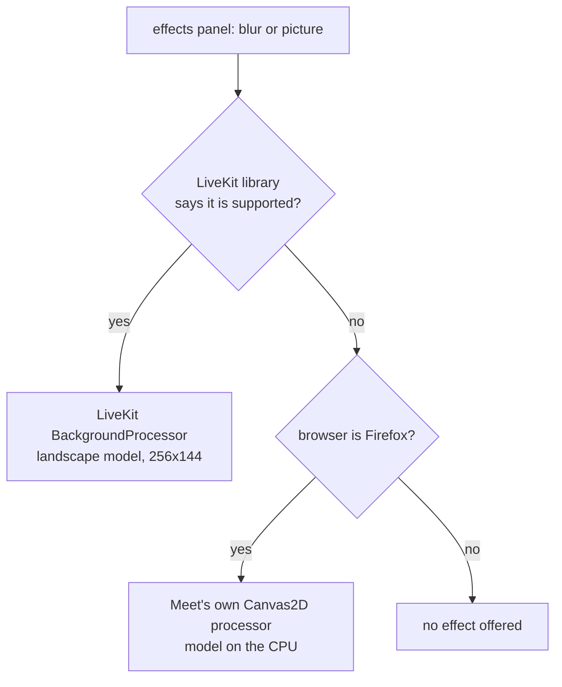
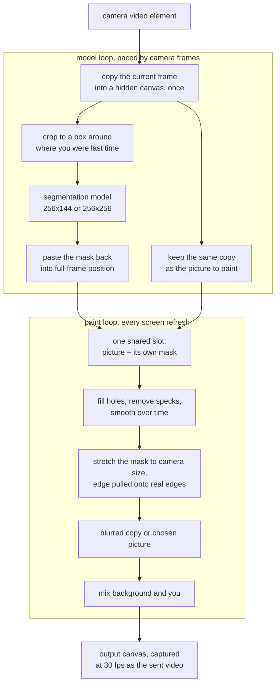

# Background blur and virtual background, rebuilt inside Meet

## TLDR

Before the change, Meet hands your camera to a LiveKit library that finds you
in the picture and blurs or replaces the rest, with a Meet-written fallback
for Firefox. After it, Meet does the whole job itself in every browser that
can turn a canvas into a video track. It times your machine on its first
twenty frames to pick between a light model and a 16 MB accurate one. It then
refines the edge of your silhouette on the graphics card before painting the
result.

## What it is for

In a meeting you may not want the others to see the room behind you. The
effects panel offers two answers: blur the background, or swap it for a
picture. Either way everyone else sees you sharp and your surroundings changed.

Every frame, two jobs have to happen:

1. **Find which pixels are you.** A machine-learning model, the segmentation
   model, answers with a small grey image called the mask: one value per
   pixel, 1 where it sees a person and 0 where it sees background.
2. **Paint the result.** Take the camera picture, take a blurred copy of it or
   the chosen image, and mix the two using the mask.

The model works on a small picture, 256 pixels wide, while the camera sends
1280 by 720. So the mask is always coarser than the video it is applied to,
and how its edge is stretched back up decides whether you look cut out with
scissors.

## How it works today

Read at the merge base, before the change.

The factory in
[`index.ts`](https://github.com/suitenumerique/meet/blob/30b68052e1890b156c6168c887aa4532638dcc04/src/frontend/src/features/rooms/livekit/components/blur/index.ts#L53-L59)
picks one of two engines, in this order:

*Before: how the engine is chosen.*

- **The LiveKit library**, `@livekit/track-processors` pinned at
  [0.7.2](https://github.com/suitenumerique/meet/blob/30b68052e1890b156c6168c887aa4532638dcc04/src/frontend/package.json#L24).
  Meet's wrapper only passes it a mode, a blur strength or an image, and the
  paths of the model and its runtime, both served from Meet's own `/assets`
  folder, in
  [`UnifiedBackgroundTrackProcessor.ts`](https://github.com/suitenumerique/meet/blob/30b68052e1890b156c6168c887aa4532638dcc04/src/frontend/src/features/rooms/livekit/components/blur/UnifiedBackgroundTrackProcessor.ts#L24-L41).
  Everything else happens inside the library. Read from the installed 0.7.2
  build, it needs WebGL2, `OffscreenCanvas`, `VideoFrame` and
  `createImageBitmap` in the browser.
- **The Firefox fallback**,
  [`BackgroundCustomProcessor.ts`](https://github.com/suitenumerique/meet/blob/30b68052e1890b156c6168c887aa4532638dcc04/src/frontend/src/features/rooms/livekit/components/blur/BackgroundCustomProcessor.ts#L75-L77),
  offered only when the browser's name says Firefox. It runs the same
  landscape model
  [on the CPU](https://github.com/suitenumerique/meet/blob/30b68052e1890b156c6168c887aa4532638dcc04/src/frontend/src/features/rooms/livekit/components/blur/BackgroundCustomProcessor.ts#L157-L160)
  at
  [256 by 144](https://github.com/suitenumerique/meet/blob/30b68052e1890b156c6168c887aa4532638dcc04/src/frontend/src/features/rooms/livekit/components/blur/BackgroundCustomProcessor.ts#L22-L23),
  is woken
  [every 1000/30 ms](https://github.com/suitenumerique/meet/blob/30b68052e1890b156c6168c887aa4532638dcc04/src/frontend/src/features/rooms/livekit/components/blur/BackgroundCustomProcessor.ts#L128-L145)
  by a timer in a worker, and paints with the browser's own
  [canvas blur filter](https://github.com/suitenumerique/meet/blob/30b68052e1890b156c6168c887aa4532638dcc04/src/frontend/src/features/rooms/livekit/components/blur/BackgroundCustomProcessor.ts#L223-L247):
  blur the stretched mask, keep the camera where the mask is, draw a blurred
  camera behind it.

In both engines one step waits for the next: find you, then paint. A slow
model makes a slow video.

## What the change does

Read at the pull request's head, after the change.

**One engine for every browser.** Both earlier engines are deleted. The
factory
[always returns](https://github.com/alexandrebayssiere7-cmd/meet/blob/2b2b89b52096bc8b996c1c3ed03af0c83909225d/src/frontend/src/features/rooms/livekit/components/blur/index.ts#L85-L95)
the new `AdvancedMattingProcessor`, and the only thing it
[requires of the browser](https://github.com/alexandrebayssiere7-cmd/meet/blob/2b2b89b52096bc8b996c1c3ed03af0c83909225d/src/frontend/src/features/rooms/livekit/components/blur/index.ts#L75-L83)
is a canvas that can be turned into a video track. The graphics card and the
model's GPU mode are tried when the effect starts, and the code falls back
when either is missing.

**Two loops that never wait for each other.** The after, as the code runs it:

*After: the pipeline in `AdvancedMattingProcessor.ts` and its helpers.*

- The model loop copies the frame
  [once](https://github.com/alexandrebayssiere7-cmd/meet/blob/2b2b89b52096bc8b996c1c3ed03af0c83909225d/src/frontend/src/features/rooms/livekit/components/blur/segmenters/SegmenterLoopRunner.ts#L92)
  and builds both the model's input and the
  [picture to paint](https://github.com/alexandrebayssiere7-cmd/meet/blob/2b2b89b52096bc8b996c1c3ed03af0c83909225d/src/frontend/src/features/rooms/livekit/components/blur/segmenters/SegmenterLoopRunner.ts#L120-L122)
  from that one copy. The mask and the picture therefore always come from
  the same instant, and they enter the
  [shared slot](https://github.com/alexandrebayssiere7-cmd/meet/blob/2b2b89b52096bc8b996c1c3ed03af0c83909225d/src/frontend/src/features/rooms/livekit/components/blur/AdvancedMattingProcessor.ts#L99-L103)
  together.
- The paint loop runs on
  [`requestAnimationFrame`](https://github.com/alexandrebayssiere7-cmd/meet/blob/2b2b89b52096bc8b996c1c3ed03af0c83909225d/src/frontend/src/features/rooms/livekit/components/blur/renderers/RenderLoopRunner.ts#L38),
  paints whatever pair the slot holds and
  [paints that pair's picture](https://github.com/alexandrebayssiere7-cmd/meet/blob/2b2b89b52096bc8b996c1c3ed03af0c83909225d/src/frontend/src/features/rooms/livekit/components/blur/renderers/RenderLoopRunner.ts#L87),
  never the live camera. With no pair yet, it paints the camera through a
  [mask of all ones](https://github.com/alexandrebayssiere7-cmd/meet/blob/2b2b89b52096bc8b996c1c3ed03af0c83909225d/src/frontend/src/features/rooms/livekit/components/blur/renderers/RenderLoopRunner.ts#L90-L96),
  which leaves the picture unchanged.
- The result is sent through
  [`captureStream(30)`](https://github.com/alexandrebayssiere7-cmd/meet/blob/2b2b89b52096bc8b996c1c3ed03af0c83909225d/src/frontend/src/features/rooms/livekit/components/blur/AdvancedMattingProcessor.ts#L183).

**Two models, chosen by timing your machine.** The landscape model of the
before stays, and a
[multiclass model](https://github.com/alexandrebayssiere7-cmd/meet/blob/2b2b89b52096bc8b996c1c3ed03af0c83909225d/src/frontend/src/features/rooms/livekit/components/blur/index.ts#L8-L9)
joins it, committed under `public/assets`. Both are served by Meet. Measured
on disk at the head: the landscape file is 250,177 bytes and the multiclass
file 16,371,837. The multiclass model sorts each pixel into six classes. The
code adds up
[the five person classes](https://github.com/alexandrebayssiere7-cmd/meet/blob/2b2b89b52096bc8b996c1c3ed03af0c83909225d/src/frontend/src/features/rooms/livekit/components/blur/segmenters/MulticlassSegmenter.ts#L18-L26)
and caps the sum at 1.

In the default automatic mode, the multiclass model is loaded first and timed
over
[5 warm-up runs](https://github.com/alexandrebayssiere7-cmd/meet/blob/2b2b89b52096bc8b996c1c3ed03af0c83909225d/src/frontend/src/features/rooms/livekit/components/blur/segmenters/SegmenterBenchmarker.ts#L77)
and
[15 timed runs](https://github.com/alexandrebayssiere7-cmd/meet/blob/2b2b89b52096bc8b996c1c3ed03af0c83909225d/src/frontend/src/features/rooms/livekit/components/blur/segmenters/SegmenterBenchmarker.ts#L85).
The frames painted while it is being timed are
[sent to the call](https://github.com/alexandrebayssiere7-cmd/meet/blob/2b2b89b52096bc8b996c1c3ed03af0c83909225d/src/frontend/src/features/rooms/livekit/components/blur/AdvancedMattingProcessor.ts#L382-L388)
already blurred. The decision, after, from
[`SegmenterBenchmarker.ts`](https://github.com/alexandrebayssiere7-cmd/meet/blob/2b2b89b52096bc8b996c1c3ed03af0c83909225d/src/frontend/src/features/rooms/livekit/components/blur/segmenters/SegmenterBenchmarker.ts#L107-L122)
and
[`AdvancedMattingProcessor.ts`](https://github.com/alexandrebayssiere7-cmd/meet/blob/2b2b89b52096bc8b996c1c3ed03af0c83909225d/src/frontend/src/features/rooms/livekit/components/blur/AdvancedMattingProcessor.ts#L395-L420):

| 12th fastest of the 15 timed runs | Model kept | Model runs on | At a 30 fps camera |
| --- | --- | --- | --- |
| under 25 ms | multiclass | every frame | 30 masks a second |
| 25 ms to 50 ms | multiclass | every 2nd frame | 15 masks a second |
| over 50 ms | landscape, timed again | every frame under 25 ms, else every 2nd | 30 or 15 |
| over 50 ms, landscape will not load | multiclass | every 2nd frame | 15 |
| model has no GPU mode on this machine | landscape, no multiclass timing | as timed | 30 or 15 |

The table mirrors the thresholds of the source, computed with a short python
run over the same comparisons: 24.9 ms keeps every frame, 25 and 50 ms keep
every 2nd, 50.1 ms switches. A machine that switches to landscape runs 40
calibration frames, 20 per model.

**The edge.** The model's mask is stretched to the camera's size by a
[guided filter](https://github.com/alexandrebayssiere7-cmd/meet/blob/2b2b89b52096bc8b996c1c3ed03af0c83909225d/src/frontend/src/features/rooms/livekit/components/blur/renderers/GpuGuidedFilter.ts#L166),
which moves the stretched edge onto the place where the camera's colours
actually change. The stretch it corrects, after, before any crop:

| Model | Mask size | Camera 1280x720, stretch per axis |
| --- | --- | --- |
| landscape | 256x144 | 5 across, 5 down |
| multiclass | 256x256 | 5 across, 2.8 down |

**The blur.** Before the blur, each background pixel is averaged only with
neighbours the mask marks as background: every sample is
[weighted by how little it is you](https://github.com/alexandrebayssiere7-cmd/meet/blob/2b2b89b52096bc8b996c1c3ed03af0c83909225d/src/frontend/src/features/rooms/livekit/components/blur/renderers/WebGl2Shaders.ts#L68-L85),
and the weights are divided out. Your own colour therefore does not bleed
into the blurred background as a pale outline.

**The defaults**, after, from
[`_getEffectsConfig`](https://github.com/alexandrebayssiere7-cmd/meet/blob/2b2b89b52096bc8b996c1c3ed03af0c83909225d/src/frontend/src/features/rooms/livekit/components/blur/AdvancedMattingProcessor.ts#L273-L285):
silhouette shrunk by 3 pixels, holes and specks up to 3 pixels removed,
each mask 70% new and 30% the previous one, guided filter radius 8, crop
around the person on. A saved choice with no model, or an unknown one, is
[set to automatic](https://github.com/alexandrebayssiere7-cmd/meet/blob/2b2b89b52096bc8b996c1c3ed03af0c83909225d/src/frontend/src/stores/userChoices.ts#L60-L65)
when the app loads.

**When a piece is missing**, after:

| Missing piece | What the code does |
| --- | --- |
| WebGL2 | [paints with Canvas2D](https://github.com/alexandrebayssiere7-cmd/meet/blob/2b2b89b52096bc8b996c1c3ed03af0c83909225d/src/frontend/src/features/rooms/livekit/components/blur/AdvancedMattingProcessor.ts#L291-L318) on a fresh canvas |
| float textures on the graphics card | [skips the guided filter](https://github.com/alexandrebayssiere7-cmd/meet/blob/2b2b89b52096bc8b996c1c3ed03af0c83909225d/src/frontend/src/features/rooms/livekit/components/blur/renderers/WebGl2Renderer.ts#L431-L439), stretches the mask plainly |
| the model will not load | [3 attempts](https://github.com/alexandrebayssiere7-cmd/meet/blob/2b2b89b52096bc8b996c1c3ed03af0c83909225d/src/frontend/src/features/rooms/livekit/components/blur/AdvancedMattingProcessor.ts#L346), then the camera is sent unchanged |
| the model takes over 2 s on one frame | [that frame is dropped](https://github.com/alexandrebayssiere7-cmd/meet/blob/2b2b89b52096bc8b996c1c3ed03af0c83909225d/src/frontend/src/features/rooms/livekit/components/blur/segmenters/Segmenter.ts#L65-L68), the loop [waits 100 ms](https://github.com/alexandrebayssiere7-cmd/meet/blob/2b2b89b52096bc8b996c1c3ed03af0c83909225d/src/frontend/src/features/rooms/livekit/components/blur/segmenters/SegmenterLoopRunner.ts#L150) and carries on |
| `captureStream` on the canvas | the factory reports the effect unsupported; the start-up also [sends the camera itself](https://github.com/alexandrebayssiere7-cmd/meet/blob/2b2b89b52096bc8b996c1c3ed03af0c83909225d/src/frontend/src/features/rooms/livekit/components/blur/AdvancedMattingProcessor.ts#L174-L181) |

Each of these records an entry in a
[shared list](https://github.com/alexandrebayssiere7-cmd/meet/blob/2b2b89b52096bc8b996c1c3ed03af0c83909225d/src/frontend/src/features/rooms/livekit/components/blur/errors/MattingErrorStore.ts#L4-L10).
The effects panel shows the entries
[marked as errors](https://github.com/alexandrebayssiere7-cmd/meet/blob/2b2b89b52096bc8b996c1c3ed03af0c83909225d/src/frontend/src/features/rooms/livekit/components/effects/EffectsConfiguration.tsx#L641-L644)
as a notice, with the wording in four languages.

The branch also ships a
[README](https://github.com/alexandrebayssiere7-cmd/meet/blob/2b2b89b52096bc8b996c1c3ed03af0c83909225d/src/frontend/src/features/rooms/livekit/components/blur/README.md?plain=1#L1)
for the folder that describes each stage.

## Concepts

- **Mask.** A grey image the size of the model's input. Each value says how
  sure the model is that this pixel is a person, from 0 to 1.
- **Segmentation model.** The trained network that produces the mask.
  Landscape answers person or not at 256x144. Multiclass answers six classes,
  such as hair, skin and clothes, at 256x256.
- **GPU mode of the model.** The model's runtime can run on the graphics card
  or on the processor. The change
  [tries the graphics card once](https://github.com/alexandrebayssiere7-cmd/meet/blob/2b2b89b52096bc8b996c1c3ed03af0c83909225d/src/frontend/src/features/rooms/livekit/components/blur/segmenters/Segmenter.ts#L95-L129)
  per page and remembers the answer.
- **12th fastest of 15.** The timing sorts the 15 runs and reads the value at
  position 11 counting from 0. Three runs out of four were at least that
  fast, so one slow outlier cannot flip the choice.
- **Crop around the person.** The model is given a box around where you were
  on the previous mask, padded by
  [8%](https://github.com/alexandrebayssiere7-cmd/meet/blob/2b2b89b52096bc8b996c1c3ed03af0c83909225d/src/frontend/src/features/rooms/livekit/components/blur/preprocessing/RoiCropper.ts#L2-L9),
  so you fill more of its small input. The box ignores moves under 3% of the
  frame. Every 30 frames it compares a small grey copy of the frame with the
  previous one, and widens to the whole frame when more than 1 pixel in 16
  changed.
- **Guided filter.** A way to enlarge a coarse mask using the full-size
  colour picture as a guide, so the mask edge lands on the real edge of your
  hair or shoulder instead of on the coarse pixel grid.
- **Smoothing over time.** Each new mask is mixed with the previous one, so
  an edge that wobbles by a pixel from frame to frame reads as still.
- **Mask of all ones.** A mask that marks every pixel as you. Mixing with it
  gives back the camera picture untouched, which is how the change keeps the
  video live when no real mask exists.
- **`captureStream`.** A browser call that turns what a canvas draws into a
  video track, the thing the media server can send to the others.
