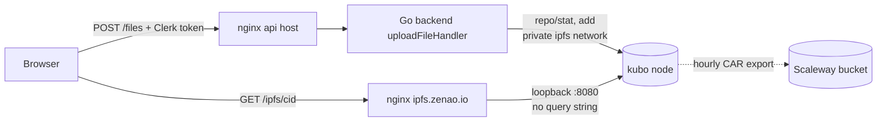

# Self-hosted kubo file store behind `POST /files`

Generated by claude-opus-5-5.

PR: [samouraiworld/zenao#1092](https://github.com/samouraiworld/zenao/pull/1092)

## TLDR

Zenao kept every uploaded picture and audio file with Pinata, a paid hosting
service, and Pinata stopped, so uploads broke. The change runs Zenao's own file
server next to the backend and sends uploads through the backend, which checks
who is uploading and how much. Links to files keep the same shape, so a file
put back on the new server shows again wherever the site already points to it.

## `ipfs://` addresses and why the bytes decide them

Zenao stores every uploaded file as an `ipfs://<cid>` string in the database.
A CID is a content address: a hash of the file's bytes, so the same bytes give
the same CID on any IPFS node. That holds only when both nodes cut and hash the
file the same way. The change pins those choices in
[`kuboAddParams`](https://github.com/samouraiworld/zenao/pull/1092/files#diff-6e6f0a4a63595e60befe5de7e6f1e9e26a7f9488e8f88ba36a49915752f57ed6R44-R53),
the parameters every add sends to the node. They match what Pinata used for
Zenao uploads, so a row written in the Pinata days names the CID the new node
computes for the same file. The after code:

```go
var kuboAddParams = url.Values{
	"cid-version": {"1"},
	"raw-leaves":  {"true"},
	"chunker":     {"size-262144"},
	"hash":        {"sha2-256"},
	"pin":         {"true"},
}
```

The parameters are written out rather than left to kubo's defaults, so a kubo
upgrade that changes a default cannot change the CID of a new upload. `pin`
tells the node to keep the file and never garbage-collect it.

## The kubo node and its two ports

kubo is the reference IPFS server. In the after state it runs as an `ipfs`
service in
[`prod.backend.docker-compose.yml`](https://github.com/samouraiworld/zenao/pull/1092/files#diff-2bcb89e0f17c6f5db930e9d53660a6de9cb4cf1e8c5a9ea63abf3bed8bcbf42fR41-R59),
with the same service in the staging and
[dev](https://github.com/samouraiworld/zenao/pull/1092/files#diff-78e7e5add2bb64ef10f3660828aecefc2cf7c1657d69dd545d4f4027a778e232R26-R28)
compose files. It listens on two ports with very different power:

- **The RPC API, port 5001**, can add, delete and reconfigure anything on the
  node. Only the backend talks to it. The compose file puts the node on a
  Docker network named `ipfs` that only the backend
  [joins](https://github.com/samouraiworld/zenao/pull/1092/files#diff-2bcb89e0f17c6f5db930e9d53660a6de9cb4cf1e8c5a9ea63abf3bed8bcbf42fR13),
  and never publishes the port.
- **The gateway, port 8080**, serves files read-only at `/ipfs/<cid>`. It is
  [published on the host's loopback only](https://github.com/samouraiworld/zenao/pull/1092/files#diff-2bcb89e0f17c6f5db930e9d53660a6de9cb4cf1e8c5a9ea63abf3bed8bcbf42fR54),
  where the host's nginx reaches it and the internet does not.

[`ipfs/zenao-config.sh`](https://github.com/samouraiworld/zenao/pull/1092/files#diff-c0b70f55fa01e3164b09d45190d4710f8e938f94432dbff22852899817b4df2a)
runs at every container start and makes the node isolated. It
[turns off](https://github.com/samouraiworld/zenao/pull/1092/files#diff-c0b70f55fa01e3164b09d45190d4710f8e938f94432dbff22852899817b4df2aR13-R27)
peer discovery, routing and announcing, so the node never joins the public IPFS
network. It sets
[`Gateway.NoFetch`](https://github.com/samouraiworld/zenao/pull/1092/files#diff-c0b70f55fa01e3164b09d45190d4710f8e938f94432dbff22852899817b4df2aR31),
so the gateway answers only for files already on disk and cannot be used to
fetch anyone else's content, and
[`Gateway.NoDNSLink`](https://github.com/samouraiworld/zenao/pull/1092/files#diff-c0b70f55fa01e3164b09d45190d4710f8e938f94432dbff22852899817b4df2aR34),
so the gateway ignores the requested host name. The trade-off is that the node
holds the only copy of each file until the backup copies it.

## The file store: kubo or Pinata

[`FileStore`](https://github.com/samouraiworld/zenao/pull/1092/files#diff-6e6f0a4a63595e60befe5de7e6f1e9e26a7f9488e8f88ba36a49915752f57ed6R23-R30)
is the after-state interface the upload endpoint writes through: one `Add`
call taking bytes and returning a CID. Two types implement it:

- [`kuboFileStore`](https://github.com/samouraiworld/zenao/pull/1092/files#diff-6e6f0a4a63595e60befe5de7e6f1e9e26a7f9488e8f88ba36a49915752f57ed6R98-R164)
  posts to the node's `/api/v0/add` with `kuboAddParams`.
- [`pinataFileStore`](https://github.com/samouraiworld/zenao/pull/1092/files#diff-6e6f0a4a63595e60befe5de7e6f1e9e26a7f9488e8f88ba36a49915752f57ed6R247-R297)
  posts to Pinata's `pinFileToIPFS` with `cidVersion: 1`.

The backend picks one at start in
[`newFileStore`](https://github.com/samouraiworld/zenao/pull/1092/files#diff-6e6f0a4a63595e60befe5de7e6f1e9e26a7f9488e8f88ba36a49915752f57ed6R62-R78)
from `ZENAO_FILE_STORE`, which
[defaults to `kubo`](https://github.com/samouraiworld/zenao/pull/1092/files#diff-dec704b60ebde2632503812758e7db9b3b1f663f8b1ac015e670644b5396a2f0R87).
Pinata is kept so Zenao can move back with a setting change and no code
change, and the identical CIDs are what make that move safe.

Both stores send the file under the fixed name `file` in
[`multipartFile`](https://github.com/samouraiworld/zenao/pull/1092/files#diff-6e6f0a4a63595e60befe5de7e6f1e9e26a7f9488e8f88ba36a49915752f57ed6R303-R307).
The user's file name is never forwarded: the stores read it as a path, where a
`/` would create a folder, and the name does not change a single file's CID.

## The upload endpoint and the order of its checks

[`uploadFileHandler`](https://github.com/samouraiworld/zenao/pull/1092/files#diff-21fb75dd19bb6d3b0b240873e471a54739c80d9ce65c84a7e1f905c76ec00ea2R59-R139)
serves `POST /files` on the Go backend in the after state. It keeps the
contract of the removed Next.js route: a multipart field `file` in,
`{"uri": "ipfs://<cid>"}` out. The checks run cheapest first, so a refused
request costs as little as possible:

| Order | Check, after | Refusal |
| --- | --- | --- |
| 1 | [method is `POST`](https://github.com/samouraiworld/zenao/pull/1092/files#diff-21fb75dd19bb6d3b0b240873e471a54739c80d9ce65c84a7e1f905c76ec00ea2R60-R64) | 405 |
| 2 | [maintenance mode off](https://github.com/samouraiworld/zenao/pull/1092/files#diff-21fb75dd19bb6d3b0b240873e471a54739c80d9ce65c84a7e1f905c76ec00ea2R65-R68) | 503 |
| 3 | [a signed-in Clerk user](https://github.com/samouraiworld/zenao/pull/1092/files#diff-21fb75dd19bb6d3b0b240873e471a54739c80d9ce65c84a7e1f905c76ec00ea2R70-R74) | 401 |
| 4 | [user not banned](https://github.com/samouraiworld/zenao/pull/1092/files#diff-21fb75dd19bb6d3b0b240873e471a54739c80d9ce65c84a7e1f905c76ec00ea2R75-R78) | 403 |
| 5 | [rate limit per user](https://github.com/samouraiworld/zenao/pull/1092/files#diff-21fb75dd19bb6d3b0b240873e471a54739c80d9ce65c84a7e1f905c76ec00ea2R79-R82) | 429 |
| 6 | [body at most 5 MiB plus 64 KiB](https://github.com/samouraiworld/zenao/pull/1092/files#diff-21fb75dd19bb6d3b0b240873e471a54739c80d9ce65c84a7e1f905c76ec00ea2R84-R94), [file at most 5 MiB](https://github.com/samouraiworld/zenao/pull/1092/files#diff-21fb75dd19bb6d3b0b240873e471a54739c80d9ce65c84a7e1f905c76ec00ea2R97-R105) | 413 |
| 7 | [file not empty](https://github.com/samouraiworld/zenao/pull/1092/files#diff-21fb75dd19bb6d3b0b240873e471a54739c80d9ce65c84a7e1f905c76ec00ea2R106-R109) | 400 |
| 8 | [content does not sniff as HTML](https://github.com/samouraiworld/zenao/pull/1092/files#diff-21fb75dd19bb6d3b0b240873e471a54739c80d9ce65c84a7e1f905c76ec00ea2R111-R117) | 415 |
| 9 | [daily quota has room](https://github.com/samouraiworld/zenao/pull/1092/files#diff-21fb75dd19bb6d3b0b240873e471a54739c80d9ce65c84a7e1f905c76ec00ea2R119-R122) | 429 |
| 10 | [store accepts the file](https://github.com/samouraiworld/zenao/pull/1092/files#diff-21fb75dd19bb6d3b0b240873e471a54739c80d9ce65c84a7e1f905c76ec00ea2R124-R135) | 507 when full, 500 otherwise |

The HTML check exists because the gateway serves files from a `zenao.io` host
name, and an uploaded HTML page there would look like a Zenao page. The check
uses Go's content sniffing on the first bytes, after skipping a UTF-8 byte order
mark, which the gateway's own sniffing skips too.

The handler is
[mounted in `main.go`](https://github.com/samouraiworld/zenao/pull/1092/files#diff-dec704b60ebde2632503812758e7db9b3b1f663f8b1ac015e670644b5396a2f0R227-R231)
behind the same tracing, CORS and auth middlewares as the Connect API, which is
how step 3 finds the user from the `Authorization: Bearer` header.

## The storage cap

`Datastore.StorageMax` is kubo's own size limit for the node's disk store,
[set to `ZENAO_IPFS_STORAGE_MAX`](https://github.com/samouraiworld/zenao/pull/1092/files#diff-c0b70f55fa01e3164b09d45190d4710f8e938f94432dbff22852899817b4df2aR38),
`20GB` by default. Before every add,
[`checkSpace`](https://github.com/samouraiworld/zenao/pull/1092/files#diff-6e6f0a4a63595e60befe5de7e6f1e9e26a7f9488e8f88ba36a49915752f57ed6R166-R194)
asks the node for its current size and refuses with `ErrStorageFull` when the
new file would pass the cap. The handler turns that error into HTTP 507. A
"no space left on device" message from kubo, in the status body or in the
late `X-Stream-Error` trailer, maps to the same error.

A check followed by a separate add races: ten uploads at once could all read
"room left" and then all write. The store makes the pair one step with
[`addSlot`](https://github.com/samouraiworld/zenao/pull/1092/files#diff-6e6f0a4a63595e60befe5de7e6f1e9e26a7f9488e8f88ba36a49915752f57ed6R86-R104),
a channel of size one that each `Add` fills before checking and empties after
adding. So kubo adds run one at a time across the backend. A channel is used
instead of a mutex because a waiting request whose client went away can stop
waiting.

## The daily quota and the rate limit

Files are kept forever, so one account could fill the disk. Two per-user
limits bound that in the after state:

- **Rate limit.** A token bucket per user ID,
  [0.5 uploads a second with bursts of 10](https://github.com/samouraiworld/zenao/pull/1092/files#diff-21fb75dd19bb6d3b0b240873e471a54739c80d9ce65c84a7e1f905c76ec00ea2R53-R54),
  built on the backend's existing `RateLimiter`.
- **Daily byte quota.**
  [`uploadQuota`](https://github.com/samouraiworld/zenao/pull/1092/files#diff-21fb75dd19bb6d3b0b240873e471a54739c80d9ce65c84a7e1f905c76ec00ea2R151-R204)
  allows 100 MiB per user in a 24-hour window that starts at that user's first
  upload. `reserve` counts the bytes before the store is called, and `release`
  gives them back when the store fails, so a failed upload costs no quota.

Both live in the backend's memory. A backend restart resets every user's
count, and `StorageMax` is what bounds the disk across restarts.

## The public gateway and what nginx lets through

Browsers read files from `https://ipfs.zenao.io/ipfs/<cid>` in the after state,
where the host's nginx forwards to the node's gateway. The
[README's nginx block](https://github.com/samouraiworld/zenao/pull/1092/files#diff-b335630551682c19a781afebcf4d07bf978fb1f8ac04c6bf87428ed5106870f5R335-R361)
is part of the design, since the node itself trusts whatever reaches it:

- The
  [only accepted path](https://github.com/samouraiworld/zenao/pull/1092/files#diff-b335630551682c19a781afebcf4d07bf978fb1f8ac04c6bf87428ed5106870f5R346)
  is `/ipfs/` followed by CID characters, with `GET` and `HEAD` only.
  Everything else is 404.
- nginx forwards the path without its query string. kubo honours
  `?filename=x.html` by serving the file as an HTML page, so the query string
  never reaches it.
- Every answer carries
  [`Content-Security-Policy: sandbox` and `X-Content-Type-Options: nosniff`](https://github.com/samouraiworld/zenao/pull/1092/files#diff-b335630551682c19a781afebcf4d07bf978fb1f8ac04c6bf87428ed5106870f5R353-R354),
  so a browser never runs an uploaded file, an SVG with a script included, as
  a page of a `zenao.io` origin.

The same server block also answers on `pinata.zenao.io`, so image links in
emails sent before the change keep working for files present on the node.

The frontend builds file links from
[`ipfsGatewayURL`](https://github.com/samouraiworld/zenao/pull/1092/files#diff-0f2798730687f58786de12297cb338dd295d21d2ac8e90d66bca85e99bde1466R19),
read from `NEXT_PUBLIC_IPFS_GATEWAY_URL` with `https://ipfs.zenao.io` as
default. `next.config.ts` reads the same variable to
[allow the host in `next/image`](https://github.com/samouraiworld/zenao/pull/1092/files#diff-e3f38f2f0e7ba92f0dd56c086ec5de704229d58d5371e8cc57e43961757d8c7bR22-R31)
and in the
[`connect-src`](https://github.com/samouraiworld/zenao/pull/1092/files#diff-e3f38f2f0e7ba92f0dd56c086ec5de704229d58d5371e8cc57e43961757d8c7bR76)
and
[`media-src`](https://github.com/samouraiworld/zenao/pull/1092/files#diff-e3f38f2f0e7ba92f0dd56c086ec5de704229d58d5371e8cc57e43961757d8c7bR79)
rules of the page's security policy. The backend reads its own copy,
`ZENAO_IPFS_GATEWAY_URL`, for links in emails, in
[`mail.go`](https://github.com/samouraiworld/zenao/pull/1092/files#diff-290f7f61576599a57c86a9c502fc99600d61741f5a8f2ea7c3cf309fe948bcc3R113-R121).

## Event images in ticket PDFs

Each ticket PDF shows the event image as a 16:9 picture. Before the change,
[`pdf.go`](https://github.com/samouraiworld/zenao/pull/1092/files#diff-acf793065fb1457574fe1b13a5f13c97da61a569e4af94e87972889f1ee65f73L264-L265)
asked Pinata's gateway to crop and shrink it by adding query parameters to the
URL. The before code:

```go
optimizedURL := fmt.Sprintf("%s?img-width=1280&img-height=720&img-quality=75&img-fit=cover", imageURI)
resp, err := http.Get(optimizedURL)
```

The kubo gateway has no resizer and serves the original, which would stretch a
square image across the frame. In the after state
[`ticketImage`](https://github.com/samouraiworld/zenao/pull/1092/files#diff-2e95499458573e9b17a3ce6d1c0ff7cb02c017ff1b5f14ed9b79a46b060f3ae8R72-R87)
does the same work inside the backend:

- **Crop and scale.**
  [`coverResize`](https://github.com/samouraiworld/zenao/pull/1092/files#diff-2e95499458573e9b17a3ce6d1c0ff7cb02c017ff1b5f14ed9b79a46b060f3ae8R164-R204)
  keeps the largest centred 16:9 area, averages the source pixels each output
  pixel covers, draws transparency over white, and the result is encoded as a
  1280x720 JPEG at quality 75, the values Pinata's resizer was asked for.
- **Decompression bomb guard.** A small file can declare huge dimensions.
  [`coverJPEG`](https://github.com/samouraiworld/zenao/pull/1092/files#diff-2e95499458573e9b17a3ce6d1c0ff7cb02c017ff1b5f14ed9b79a46b060f3ae8R140-R147)
  reads the declared size first and refuses anything over
  [16 million pixels](https://github.com/samouraiworld/zenao/pull/1092/files#diff-2e95499458573e9b17a3ce6d1c0ff7cb02c017ff1b5f14ed9b79a46b060f3ae8R34)
  before decoding. The download itself stops at
  [20 MiB](https://github.com/samouraiworld/zenao/pull/1092/files#diff-2e95499458573e9b17a3ce6d1c0ff7cb02c017ff1b5f14ed9b79a46b060f3ae8R30).
- **One decode at a time.** A decode can take hundreds of MB, so
  [`ticketImageDecodeSlot`](https://github.com/samouraiworld/zenao/pull/1092/files#diff-2e95499458573e9b17a3ce6d1c0ff7cb02c017ff1b5f14ed9b79a46b060f3ae8R65-R67)
  lets one run at a time and gives up after 30 seconds of waiting.
- **Shared work.** Requests for the same URL at the same moment share one
  download through
  [`singleflight`](https://github.com/samouraiworld/zenao/pull/1092/files#diff-2e95499458573e9b17a3ce6d1c0ff7cb02c017ff1b5f14ed9b79a46b060f3ae8R61-R63),
  and results stay in a
  [64-entry cache](https://github.com/samouraiworld/zenao/pull/1092/files#diff-2e95499458573e9b17a3ce6d1c0ff7cb02c017ff1b5f14ed9b79a46b060f3ae8R111-R122),
  since one email can hold many tickets for one event. A gateway URL never
  expires, since its bytes cannot change; any other URL expires after 10
  minutes. A full cache is emptied whole.

The crop for a few source sizes, after the change. Computed with a Python
mirror of the crop lines of `coverResize`, not by the project's tests:

| Source | Kept area | Offset from top-left | Cut away |
| --- | --- | --- | --- |
| 1920x1080 | 1920x1080 | 0, 0 | nothing, then scaled down |
| 640x360 | 640x360 | 0, 0 | nothing, then scaled up |
| 1080x1080 | 1080x607 | 0, 236 | top and bottom bands |
| 800x1200 | 800x450 | 0, 375 | most of the height |
| 4000x1000 | 1777x1000 | 1111, 0 | left and right bands |

[`pdf.go`](https://github.com/samouraiworld/zenao/pull/1092/files#diff-acf793065fb1457574fe1b13a5f13c97da61a569e4af94e87972889f1ee65f73R262-R280)
now registers those bytes with fpdf from memory, with no temporary file. fpdf
ignores every call after an error, so a failed image clears its own error to
let the caller draw the placeholder, and an error that was already there is
returned untouched.

## Backups as CAR files

The node holds the only copy of each upload, so
[`scripts/ipfs-backup.sh`](https://github.com/samouraiworld/zenao/pull/1092/files#diff-22e1f5c9759559d2bbc72883a65a2d27fca9c5bb6e61991abafa727397c054c6)
runs hourly from cron in the after state. A CAR file is IPFS's archive format:
one file holding a CID's blocks, which `ipfs dag import` loads back with the
same CID. Each run:

1. [takes a lock](https://github.com/samouraiworld/zenao/pull/1092/files#diff-22e1f5c9759559d2bbc72883a65a2d27fca9c5bb6e61991abafa727397c054c6R56),
   so a slow run and the next one never overlap;
2. [lists every pinned CID](https://github.com/samouraiworld/zenao/pull/1092/files#diff-22e1f5c9759559d2bbc72883a65a2d27fca9c5bb6e61991abafa727397c054c6R63)
   and fails loudly when the node is down or holds nothing;
3. [exports each CID](https://github.com/samouraiworld/zenao/pull/1092/files#diff-22e1f5c9759559d2bbc72883a65a2d27fca9c5bb6e61991abafa727397c054c6R92)
   not yet in `exported.txt`, the manifest of CIDs already backed up;
4. [copies the new CAR files](https://github.com/samouraiworld/zenao/pull/1092/files#diff-22e1f5c9759559d2bbc72883a65a2d27fca9c5bb6e61991abafa727397c054c6R117)
   to Scaleway Object Storage with rclone, then
   [records and deletes them](https://github.com/samouraiworld/zenao/pull/1092/files#diff-22e1f5c9759559d2bbc72883a65a2d27fca9c5bb6e61991abafa727397c054c6R121-R122)
   locally only after the copy succeeded.

Files are never modified once added, so exporting each CID once is a complete
backup. Uploads newer than the last successful run exist only on the server
disk. The README asks for a bucket key without delete rights and with
versioning on, so a compromised server cannot erase the backups.

## `copy-ipfs-files`, the way back to Pinata

Before the change, the `pin-ipfs-cids` command asked Pinata to
[pin each CID by hash](https://github.com/samouraiworld/zenao/pull/1092/files#diff-7a4c503f300ac33083064791b423c6315d8b20cb40f73ee2259e0e89d09a948bL222-L231),
which made Pinata fetch the bytes from the public IPFS network. An isolated
node is not on that network, so in the after state
[`copy-ipfs-files`](https://github.com/samouraiworld/zenao/pull/1092/files#diff-5fcdaf8a38fe385cffccad2b1f3336e67e4f01f68cde112181b360a5e9d17ed3R19-R34)
pushes the bytes instead:

- It collects every CID the database names, from the URI columns, from
  `ipfs://` links inside markdown and front-matter text, and from
  [seven hardcoded default images](https://github.com/samouraiworld/zenao/pull/1092/files#diff-5fcdaf8a38fe385cffccad2b1f3336e67e4f01f68cde112181b360a5e9d17ed3R190-R198).
- [`copyFiles`](https://github.com/samouraiworld/zenao/pull/1092/files#diff-5fcdaf8a38fe385cffccad2b1f3336e67e4f01f68cde112181b360a5e9d17ed3R125-R158)
  reads each one from kubo with
  [`Cat`](https://github.com/samouraiworld/zenao/pull/1092/files#diff-6e6f0a4a63595e60befe5de7e6f1e9e26a7f9488e8f88ba36a49915752f57ed6R199-R234),
  which reads local blocks only and never waits on the network, then adds it
  to Pinata.
- [`sameCID`](https://github.com/samouraiworld/zenao/pull/1092/files#diff-5fcdaf8a38fe385cffccad2b1f3336e67e4f01f68cde112181b360a5e9d17ed3R167-R174)
  checks that Pinata returned the same content address, whatever CID version
  or text encoding it is written in.
- Missing files are counted apart from failures: a CID the node never held was
  lost with the old Pinata account and is missing on both sides.

## How an upload works, in 5 steps

The after state, for a user setting an event image of 300 KB:

1. The image field calls the function from
   [`useUploadFile`](https://github.com/samouraiworld/zenao/pull/1092/files#diff-666ec7d0be592194cb4161d896bcc8ba8940b1b6ef90434b1e73aad3992a354fR64-R66),
   which gets the Clerk session token and posts the file to
   [`<backend>/files`](https://github.com/samouraiworld/zenao/pull/1092/files#diff-666ec7d0be592194cb4161d896bcc8ba8940b1b6ef90434b1e73aad3992a354fR33-R36)
   as `multipart/form-data` field `file`, with `Authorization: Bearer <token>`.
2. nginx on the API host lets the body through, since the `/files` location
   [allows 6 MB](https://github.com/samouraiworld/zenao/pull/1092/files#diff-b335630551682c19a781afebcf4d07bf978fb1f8ac04c6bf87428ed5106870f5R377-R383),
   and the backend runs the checks of the table above.
3. `kuboFileStore.Add` checks the storage cap, posts to
   `http://ipfs:5001/api/v0/add?cid-version=1&raw-leaves=true&...`, and reads
   `{"Hash":"bafkrei..."}` back.
4. The backend answers `200 {"uri":"ipfs://bafkrei..."}` and the frontend saves
   that string with the event.
5. Pages render it as `https://ipfs.zenao.io/ipfs/bafkrei...`, which nginx
   forwards to the node's gateway on `127.0.0.1:8080`.

The same flow as a picture, after the change:



## The parts, at a glance

The after state:

| Part | File | Job |
| --- | --- | --- |
| Upload endpoint | [`backend/upload_file.go`](https://github.com/samouraiworld/zenao/pull/1092/files#diff-21fb75dd19bb6d3b0b240873e471a54739c80d9ce65c84a7e1f905c76ec00ea2) | checks the user, size, type and quota, then stores |
| File stores | [`backend/filestore.go`](https://github.com/samouraiworld/zenao/pull/1092/files#diff-6e6f0a4a63595e60befe5de7e6f1e9e26a7f9488e8f88ba36a49915752f57ed6) | kubo and Pinata clients giving identical CIDs |
| Wiring | [`backend/main.go`](https://github.com/samouraiworld/zenao/pull/1092/files#diff-dec704b60ebde2632503812758e7db9b3b1f663f8b1ac015e670644b5396a2f0) | new settings, store selection, route |
| Ticket images | [`backend/pdf_image.go`](https://github.com/samouraiworld/zenao/pull/1092/files#diff-2e95499458573e9b17a3ce6d1c0ff7cb02c017ff1b5f14ed9b79a46b060f3ae8) | local crop and resize for PDFs |
| Copy command | [`backend/copy_ipfs_files.go`](https://github.com/samouraiworld/zenao/pull/1092/files#diff-5fcdaf8a38fe385cffccad2b1f3336e67e4f01f68cde112181b360a5e9d17ed3) | copies every referenced file from kubo to Pinata |
| Client upload | [`lib/files.ts`](https://github.com/samouraiworld/zenao/pull/1092/files#diff-666ec7d0be592194cb4161d896bcc8ba8940b1b6ef90434b1e73aad3992a354f) | posts to the backend with the token, reads errors |
| Node settings | [`ipfs/zenao-config.sh`](https://github.com/samouraiworld/zenao/pull/1092/files#diff-c0b70f55fa01e3164b09d45190d4710f8e938f94432dbff22852899817b4df2a) | isolation, gateway limits, storage cap |
| Node service | [`prod.backend.docker-compose.yml`](https://github.com/samouraiworld/zenao/pull/1092/files#diff-2bcb89e0f17c6f5db930e9d53660a6de9cb4cf1e8c5a9ea63abf3bed8bcbf42f) | pinned kubo image, private network, loopback gateway |
| Deploy | [`.github/workflows/deploy-prod.yml`](https://github.com/samouraiworld/zenao/pull/1092/files#diff-4ce342fb97e7d7feb8a578c91ba89fe4c27ddf16b4306909fe6d90220141913d) | starts `ipfs` after the backend, so a failing node affects uploads only |
| Backup | [`scripts/ipfs-backup.sh`](https://github.com/samouraiworld/zenao/pull/1092/files#diff-22e1f5c9759559d2bbc72883a65a2d27fca9c5bb6e61991abafa727397c054c6) | hourly CAR export to object storage |
| Runbook | [`README.md`](https://github.com/samouraiworld/zenao/pull/1092/files#diff-b335630551682c19a781afebcf4d07bf978fb1f8ac04c6bf87428ed5106870f5R279-R500) | DNS, nginx, first start, default images, backups, way back |

## Before and after

**Before:** the browser posted the file to the Next.js route
[`/api/files`](https://github.com/samouraiworld/zenao/pull/1092/files#diff-bbf98178895f38af6bab90a29bf3a95c41e8df01df1847b1d7b8803b3d7a5bddL11-L43),
which checked the Clerk user and the ban flag and handed the file to Pinata
through the `pinata-web3` SDK, with no size, type or volume limit. Files were
shown from `pinata.zenao.io`, Pinata's gateway, which also resized ticket images.

**After:** the browser posts to the Go backend's `POST /files`, which adds the
checks above and stores the file on Zenao's own kubo node. Files are shown from
`ipfs.zenao.io` through nginx, and the backend resizes ticket images itself.
The Next.js route and `pinata-web3` are removed.

## Upgrading

The change touches settings and needs server steps, all in the README runbook:

- **New backend settings:** `ZENAO_FILE_STORE` (default `kubo`),
  `ZENAO_IPFS_API_URL` (default `http://127.0.0.1:5001`, `http://ipfs:5001` in
  the compose files), `ZENAO_IPFS_GATEWAY_URL` (default
  `https://ipfs.zenao.io`), and `ZENAO_PINATA_JWT` with `ZENAO_PINATA_GROUP`
  for the Pinata store.
- **New node setting:** `ZENAO_IPFS_STORAGE_MAX` in the compose project's
  `.env`, default `20GB`.
- **Frontend:** `NEXT_PUBLIC_IPFS_GATEWAY_URL` replaces
  `NEXT_PUBLIC_GATEWAY_URL`; `PINATA_JWT` and `PINATA_GROUP` go away.
- **Server:** DNS for `ipfs` and `pinata`, the gateway's nginx site, a 6 MB
  body limit on `/files`, the restore of the
  [seven default images](https://github.com/samouraiworld/zenao/pull/1092/files#diff-b335630551682c19a781afebcf4d07bf978fb1f8ac04c6bf87428ed5106870f5R406-R427)
  by CID, and the backup cron.
- **Command rename:** `pin-ipfs-cids` becomes `copy-ipfs-files`.
- **Rollout order:** the frontend deploys from `main` on its own, and uploads
  fail until the backend serves `/files`.

## Words used here

| Name | What it is |
| --- | --- |
| CID | Content identifier: a hash of a file's bytes, written `bafy...` or `bafkrei...`; equal bytes and equal add parameters give an equal CID. |
| kubo | The reference IPFS server, run as the `ipfs` compose service, image `ipfs/kubo:v0.43.1`. |
| RPC API | kubo's control interface on port 5001, `POST /api/v0/<command>`; reachable only from the backend. |
| Gateway | kubo's read-only HTTP server on port 8080, `GET /ipfs/<cid>`. |
| `Gateway.NoFetch` | kubo setting: the gateway answers only for files already on the node, never fetching from the network. |
| `Datastore.StorageMax` | kubo's disk cap, from `ZENAO_IPFS_STORAGE_MAX`, default `20GB`. |
| `FileStore` | Go interface with one `Add(ctx, name, data)` call returning a CID. |
| `ErrStorageFull` | Error a store returns when the cap is reached; the endpoint answers 507. |
| `addSlot` | One-place channel making kubo's size check and add a single step. |
| `uploadQuota` | In-memory byte counter per user, 100 MiB per 24 hours from the first upload. |
| `POST /files` | Backend upload endpoint, multipart field `file`, Clerk bearer token, returns `{"uri":"ipfs://<cid>"}`. |
| `useUploadFile` | React hook returning an upload function that carries the user's token. |
| CAR file | IPFS archive of one CID's blocks; `ipfs dag export` writes it and `ipfs dag import` restores the same CID. |
| `exported.txt` | Backup manifest listing CIDs already copied to the bucket. |
| `copy-ipfs-files` | Backend command copying every referenced file from kubo to Pinata and checking the CID. |
| `ticketImage` | Returns an event image as a 1280x720 JPEG for ticket PDFs, cached per URL. |

<details>
<summary>Read the code in this order</summary>

`hot` is the risky code to read closely, `warm` other code, `cold` a test or a
generated file.

### 1. `hot` · The upload checks, [`backend/upload_file.go`](https://github.com/samouraiworld/zenao/pull/1092/files#diff-21fb75dd19bb6d3b0b240873e471a54739c80d9ce65c84a7e1f905c76ec00ea2R59-R139)
Decides who may store a file, how big, of what type and how much per day.
**If wrong:** any account can host pages on a `zenao.io` host name or fill the disk.
```go
	if !h.quota.reserve(user.ID, int64(len(data))) {
		writeUploadError(w, http.StatusTooManyRequests, "Daily Upload Quota Exceeded")
		return
	}

	cid, err := h.store.Add(r.Context(), header.Filename, data)
	if err != nil {
		h.quota.release(user.ID, int64(len(data)))
```

### 2. `hot` · The kubo add and the cap, [`backend/filestore.go`](https://github.com/samouraiworld/zenao/pull/1092/files#diff-6e6f0a4a63595e60befe5de7e6f1e9e26a7f9488e8f88ba36a49915752f57ed6R98-R194)
Decides the CID a file gets and whether the node has room for it.
**If wrong:** CIDs stop matching Pinata's, or concurrent uploads pass the cap.
```go
	select {
	case k.addSlot <- struct{}{}:
	case <-ctx.Done():
		return "", ctx.Err()
	}
	defer func() { <-k.addSlot }()

	if err := k.checkSpace(ctx, len(data)); err != nil {
		return "", err
	}
```

### 3. `warm` · The route and settings, [`backend/main.go`](https://github.com/samouraiworld/zenao/pull/1092/files#diff-dec704b60ebde2632503812758e7db9b3b1f663f8b1ac015e670644b5396a2f0R220-R231)
Picks the store and mounts `/files` behind tracing, CORS and auth.
**If wrong:** the handler sees no user, or uploads go to the wrong store.
```go
	fileStore, err := newFileStore(conf.fileStore, conf.ipfsAPIURL, conf.pinataJWT, conf.pinataGroup)
	if err != nil {
		return err
	}
	logger.Info("file store initialized", zap.String("kind", conf.fileStore))
	mux.Handle(uploadFilePath, middlewares(newUploadFileHandler(logger, auth, fileStore, conf.maintenance),
		withTracing(),
		withConnectCORS(allowedOrigins...),
		auth.WithAuth(),
	))
```

### 4. `hot` · The client call, [`lib/files.ts`](https://github.com/samouraiworld/zenao/pull/1092/files#diff-666ec7d0be592194cb4161d896bcc8ba8940b1b6ef90434b1e73aad3992a354fR15-R66)
Sends the token and turns non-JSON proxy answers into readable errors.
**If wrong:** uploads fail with a parse error instead of "file too large".
```ts
  const uploadRequest = await fetch(uploadEndpoint, {
    method: "POST",
    headers: { Authorization: `Bearer ${token}` },
```

### 5. `warm` · The node's isolation, [`ipfs/zenao-config.sh`](https://github.com/samouraiworld/zenao/pull/1092/files#diff-c0b70f55fa01e3164b09d45190d4710f8e938f94432dbff22852899817b4df2aR13-R43)
Keeps the node off the public network and its gateway local-only.
**If wrong:** the gateway becomes an open public gateway serving anyone's content.
```sh
ipfs config --json Gateway.NoFetch true
ipfs config --json Gateway.ExposeRoutingAPI false
ipfs config --json Gateway.NoDNSLink true
```

### 6. `warm` · The node service, [`prod.backend.docker-compose.yml`](https://github.com/samouraiworld/zenao/pull/1092/files#diff-2bcb89e0f17c6f5db930e9d53660a6de9cb4cf1e8c5a9ea63abf3bed8bcbf42fR41-R59)
Decides which containers reach the RPC API and where the gateway listens.
**If wrong:** another container or the internet gets full control of the node.
```yaml
    networks:
      - ipfs
    volumes:
      - ipfs-data:/data/ipfs
      - ./ipfs/zenao-config.sh:/container-init.d/001-zenao-config.sh:ro
    ports:
      - 127.0.0.1:8080:8080
```

### 7. `hot` · The gateway's nginx block, [`README.md`](https://github.com/samouraiworld/zenao/pull/1092/files#diff-b335630551682c19a781afebcf4d07bf978fb1f8ac04c6bf87428ed5106870f5R346-R355)
Lets only `/ipfs/<cid>` through, without a query string, sandboxed.
**If wrong:** an uploaded file runs as a page on a `zenao.io` origin.
```nginx
  location ~ "^/ipfs/[A-Za-z0-9]+\z" {
    limit_except GET HEAD { deny all; }
    proxy_pass http://127.0.0.1:8080$uri;
```

### 8. `hot` · Ticket image processing, [`backend/pdf_image.go`](https://github.com/samouraiworld/zenao/pull/1092/files#diff-2e95499458573e9b17a3ce6d1c0ff7cb02c017ff1b5f14ed9b79a46b060f3ae8R72-R159)
Downloads, bounds, crops and caches the image every ticket email embeds.
**If wrong:** one crafted image exhausts the backend's memory while mails are built.
```go
	if cfg.Width <= 0 || cfg.Height <= 0 || int64(cfg.Width)*int64(cfg.Height) > maxTicketImagePixels {
		return nil, fmt.Errorf("unsupported image size %dx%d", cfg.Width, cfg.Height)
	}
```

### 9. `hot` · fpdf error handling, [`backend/pdf.go`](https://github.com/samouraiworld/zenao/pull/1092/files#diff-acf793065fb1457574fe1b13a5f13c97da61a569e4af94e87972889f1ee65f73R262-R280)
Registers the image from memory and keeps fpdf usable after a bad image.
**If wrong:** a broken image leaves the PDF silently empty past that point.
```go
	if pdf.Err() || info == nil {
		err := pdf.Error()
		pdf.ClearError()
		return fmt.Errorf("failed to register image: %v", err)
	}
```

### 10. `hot` · The backup, [`scripts/ipfs-backup.sh`](https://github.com/samouraiworld/zenao/pull/1092/files#diff-22e1f5c9759559d2bbc72883a65a2d27fca9c5bb6e61991abafa727397c054c6R56-R122)
Decides which files reach the bucket and when local copies are deleted.
**If wrong:** an upload is lost with the disk while the log reports success.
```bash
for car in "${pending[@]}"; do
  echo "$(basename "$car" .car)" >>"$manifest"
  rm -f "$car"
done
```

### 11. `hot` · The copy command, [`backend/copy_ipfs_files.go`](https://github.com/samouraiworld/zenao/pull/1092/files#diff-5fcdaf8a38fe385cffccad2b1f3336e67e4f01f68cde112181b360a5e9d17ed3R125-R158)
Moves every referenced file back to Pinata and proves each CID matches.
**If wrong:** moving back to Pinata leaves files behind without saying so.
```go
		case !sameCID(got, cid):
			logger.Error("copied with a different CID", zap.String("cid", cid), zap.String("got", got))
			res.failed++
```

### 12. `cold` · The tests, [`backend/filestore_test.go`](https://github.com/samouraiworld/zenao/pull/1092/files#diff-4eb3b9252a4dcbcedf64b3877f96b4687b1c12375288779cabe2739c061676e9), [`backend/upload_file_test.go`](https://github.com/samouraiworld/zenao/pull/1092/files#diff-5e8d30c80c4a5b61420356b9bdb7233c86114be970e5dbeb2c08a80cae1176f7), [`backend/pdf_image_test.go`](https://github.com/samouraiworld/zenao/pull/1092/files#diff-6d29069dd327271078323d7f62377d9161bd251d4f41e5a4dce658e73c02db6c)
Run the stores and the handler against `httptest` servers, and the crop,
cache expiry and JPEG output of the ticket image code.
**If wrong:** the checks above change with no test failing.

</details>
