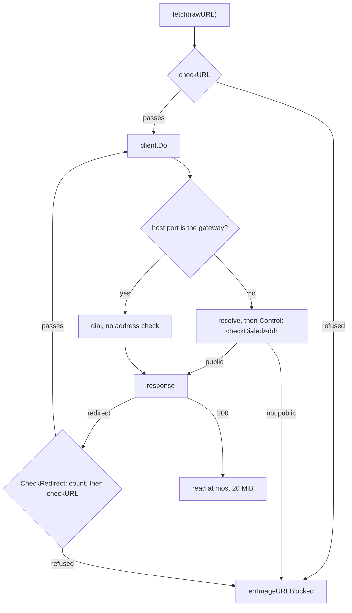

# `imageFetcher`, the restricted download of ticket PDF images

Generated by claude-opus-5-5.

PR: [samouraiworld/zenao#1093](https://github.com/samouraiworld/zenao/pull/1093)

## TLDR

A ticket PDF shows the event's picture, and the organizer can point that
picture at any web address. The server downloaded whatever address it got,
machines inside Zenao's own network included, with no limit on time or size.
Now it downloads only from Zenao's IPFS file server or from public web servers,
within 20 seconds and 20 MiB, and any other address leaves a grey box in the
ticket where the picture would be.

## The event image URL

An organizer sets the event's `ImageURI` when creating or editing the event.
[`validateEvent`](https://github.com/samouraiworld/zenao/blob/ae0009a256154b0b49e6a131dc9848f88c291237/backend/create_event.go#L248)
checks only that the string is
[1 to 400 characters long](https://github.com/samouraiworld/zenao/blob/ae0009a256154b0b49e6a131dc9848f88c291237/backend/create_event.go#L258)
and that
[`url.Parse` accepts it](https://github.com/samouraiworld/zenao/blob/ae0009a256154b0b49e6a131dc9848f88c291237/backend/create_event.go#L262),
so any scheme and any host get through. An image uploaded through Zenao is
stored as `ipfs://<cid>`.
[`web2URL`](https://github.com/samouraiworld/zenao/blob/ae0009a256154b0b49e6a131dc9848f88c291237/backend/mail.go#L108-L115)
rewrites that form to `https://pinata.zenao.io/ipfs/<cid>`, the host coming from
the constant
[`gatewayDomain`](https://github.com/samouraiworld/zenao/blob/ae0009a256154b0b49e6a131dc9848f88c291237/backend/mail.go#L117).
Every other URI comes back unchanged.

The backend downloads that URL each time it draws a ticket PDF, in
[`GeneratePDFTicket`](https://github.com/samouraiworld/zenao/blob/ae0009a256154b0b49e6a131dc9848f88c291237/backend/pdf.go#L126-L128).
It draws one PDF per ticket for the confirmation email of a
[registration](https://github.com/samouraiworld/zenao/blob/ae0009a256154b0b49e6a131dc9848f88c291237/backend/participate.go#L209)
and of a
[paid order](https://github.com/samouraiworld/zenao/blob/ae0009a256154b0b49e6a131dc9848f88c291237/backend/confirm_ticket_payment.go#L234),
and for a
[broadcast with tickets attached](https://github.com/samouraiworld/zenao/blob/ae0009a256154b0b49e6a131dc9848f88c291237/backend/broadcast_event.go#L101-L103).
[`embedImageURL`](https://github.com/samouraiworld/zenao/blob/ae0009a256154b0b49e6a131dc9848f88c291237/backend/pdf.go#L268)
first appends Pinata's resize parameters, `?img-width=1280&img-height=720&...`,
to the URL.

## Public unicast addresses

A public unicast address is one the internet routes to a single machine. Every
other address names the backend's own machine, a machine on its private
network, a group of machines, or nothing at all. The change refuses all of
those. An IPv4 address written in IPv6 form, `::ffff:127.0.0.1`, is judged as
the IPv4 address it carries, since
[`Unmap`](https://github.com/samouraiworld/zenao/blob/ae0009a256154b0b49e6a131dc9848f88c291237/backend/image_fetch.go#L184)
turns it back into one first.

The ranges refused after the change, by
[`isPublicImageAddr`](https://github.com/samouraiworld/zenao/blob/ae0009a256154b0b49e6a131dc9848f88c291237/backend/image_fetch.go#L183-L199):

| Range | Refused example | Refused by |
| --- | --- | --- |
| Loopback, the backend's own machine | `127.0.0.1`, `::1` | Go's [`IsGlobalUnicast`](https://github.com/samouraiworld/zenao/blob/ae0009a256154b0b49e6a131dc9848f88c291237/backend/image_fetch.go#L185) |
| Link-local, the cloud metadata service at `169.254.169.254` included | `169.254.169.254`, `fe80::1` | [`IsGlobalUnicast`](https://github.com/samouraiworld/zenao/blob/ae0009a256154b0b49e6a131dc9848f88c291237/backend/image_fetch.go#L185) |
| Multicast and broadcast | `224.0.0.1`, `255.255.255.255`, `ff02::1` | [`IsGlobalUnicast`](https://github.com/samouraiworld/zenao/blob/ae0009a256154b0b49e6a131dc9848f88c291237/backend/image_fetch.go#L185) |
| Unspecified | `0.0.0.0`, `::` | [`IsGlobalUnicast`](https://github.com/samouraiworld/zenao/blob/ae0009a256154b0b49e6a131dc9848f88c291237/backend/image_fetch.go#L185) |
| Private networks | `10.0.0.1`, `192.168.1.1`, `fd12:3456::1` | Go's [`IsPrivate`](https://github.com/samouraiworld/zenao/blob/ae0009a256154b0b49e6a131dc9848f88c291237/backend/image_fetch.go#L185) |
| Carrier-grade NAT space | `100.64.0.1` | [`nonPublicImagePrefixes`](https://github.com/samouraiworld/zenao/blob/ae0009a256154b0b49e6a131dc9848f88c291237/backend/image_fetch.go#L162) |
| IPv4 "this network", benchmarking, reserved | `0.1.2.3`, `198.18.0.1`, `240.0.0.1` | [`nonPublicImagePrefixes`](https://github.com/samouraiworld/zenao/blob/ae0009a256154b0b49e6a131dc9848f88c291237/backend/image_fetch.go#L161-L169) |
| IPv6 outside `2000::/3`: NAT64, IPv4-compatible, site-local, unallocated | `64:ff9b::a9fe:a9fe`, `::127.0.0.1`, `fec0::1`, `4000::1` | [`globalUnicastIPv6`](https://github.com/samouraiworld/zenao/blob/ae0009a256154b0b49e6a131dc9848f88c291237/backend/image_fetch.go#L188-L192) |
| IPv6 special blocks inside `2000::/3`: Teredo, documentation, 6to4 | `2001::1`, `2001:db8::1`, `2002:7f00:1::1`, `3fff::1` | [`nonPublicImagePrefixes`](https://github.com/samouraiworld/zenao/blob/ae0009a256154b0b49e6a131dc9848f88c291237/backend/image_fetch.go#L170-L173) |

> Every example sits in the refused list of
> [`TestIsPublicImageAddr`](https://github.com/samouraiworld/zenao/blob/ae0009a256154b0b49e6a131dc9848f88c291237/backend/image_fetch_test.go#L19-L29),
> which passes at this head. The last column comes from running Go 1.27.3's
> `netip` `IsGlobalUnicast` and `IsPrivate` on each example.

A NAT64 or 6to4 address carries an IPv4 address inside it, which a translating
router would reach for the backend, so a public-looking IPv6 form could still
lead to `169.254.169.254`. The test keeps
[`8.8.8.8`, `2606:4700:4700::1111` and `::ffff:8.8.8.8`](https://github.com/samouraiworld/zenao/blob/ae0009a256154b0b49e6a131dc9848f88c291237/backend/image_fetch_test.go#L34)
public.

## Name resolution and the dial

A URL names a host, `images.example.com`. The backend learns its address only
when it resolves that name, right before it connects, which Go calls the dial.
A check on the name says nothing about the address: whoever runs the name's DNS
server picks the answer, and can answer `127.0.0.1`. So the address worth
checking is the one being connected to.

Go's [`net.Dialer`](https://pkg.go.dev/net#Dialer) has a `Control` hook, called
before each connection with the `ip:port` about to be dialed. The test URL
[`http://localhost/a.png`](https://github.com/samouraiworld/zenao/blob/ae0009a256154b0b49e6a131dc9848f88c291237/backend/image_fetch_test.go#L46)
shows the hook sees the resolved address. Its name and port pass the URL check,
and only the address check refuses it.

Two spellings make the name checked differ from the name dialed. The code's
comment says Go's HTTP client
[dials a non-ASCII host in its IDNA form](https://github.com/samouraiworld/zenao/blob/ae0009a256154b0b49e6a131dc9848f88c291237/backend/image_fetch.go#L102-L103),
the ASCII spelling of an international domain name. A fullwidth `ｇateway.example`
would then be compared under one spelling and dialed under another. A trailing
dot, `gateway.example.`, names the same DNS host as `gateway.example` and is a
different string.

## The IPFS gateway and its paths

An IPFS gateway is a web server that serves stored files at `/ipfs/<cid>`.
Zenao's is the host in `gatewayDomain`. A gateway host can answer more than
that path: the tests refuse
[`/ipns/` and `/api/v0/` paths](https://github.com/samouraiworld/zenao/blob/ae0009a256154b0b49e6a131dc9848f88c291237/backend/image_fetch_test.go#L71-L79)
on it.

The gateway is reached
[whatever address it resolves to](https://github.com/samouraiworld/zenao/blob/ae0009a256154b0b49e6a131dc9848f88c291237/backend/image_fetch.go#L42-L44),
since it can run on a private network. In exchange, a URL on the gateway's host
and port must use the gateway's scheme and a path under `/ipfs/`.

## Why `http.Get` was not enough

The code assumed `ImageURI` names an image on the gateway or on a public site.
`validateEvent` lets any URI through, so nothing stopped an organizer from
setting `http://169.254.169.254/latest/meta-data/` or `http://10.0.0.5:8080/`.
The before code, `embedImageURL` at the merge base:

```go
// before
resp, err := http.Get(optimizedURL)
...
bodyStart, err := io.ReadAll(io.LimitReader(resp.Body, 512))
...
_, err = io.Copy(imgFile, resp.Body)
```

`http.Get` uses Go's default client. That client
[follows up to 10 redirects](https://pkg.go.dev/net/http#Client) to any
address, and its `Timeout` is zero, which the same page defines as no timeout.
Its [transport](https://pkg.go.dev/net/http#DefaultTransport) bounds only the
connect, 30 s, and the TLS handshake, 10 s, and sends through the proxy that
`HTTP_PROXY` names. The `io.Copy` wrote the whole body to a temporary file with
no size cap.

Each ticket PDF therefore sent a GET from the backend to the organizer's
address. The response landed in the PDF when its first bytes looked like a
JPEG, PNG or GIF, and the placeholder was drawn otherwise. The request went out
either way.

## How `imageFetcher` works

The flow of one fetch, after the change:



**The policy, built once.**
[`ticketImageFetcher`](https://github.com/samouraiworld/zenao/blob/ae0009a256154b0b49e6a131dc9848f88c291237/backend/image_fetch.go#L38)
is built at program start from `"https://" + gatewayDomain`.
[`newImageFetchPolicy`](https://github.com/samouraiworld/zenao/blob/ae0009a256154b0b49e6a131dc9848f88c291237/backend/image_fetch.go#L54-L70)
refuses a gateway URL whose scheme is not http or https, or whose host is empty
or non-ASCII.
[`mustNewImageFetchPolicy`](https://github.com/samouraiworld/zenao/blob/ae0009a256154b0b49e6a131dc9848f88c291237/backend/image_fetch.go#L72-L78)
panics then, so a bad gateway stops the backend at start rather than at the
first ticket.

**The URL check.**
[`checkURL`](https://github.com/samouraiworld/zenao/blob/ae0009a256154b0b49e6a131dc9848f88c291237/backend/image_fetch.go#L95-L126)
refuses
[a scheme other than http or https](https://github.com/samouraiworld/zenao/blob/ae0009a256154b0b49e6a131dc9848f88c291237/backend/image_fetch.go#L96-L98),
an empty host,
[a non-ASCII host](https://github.com/samouraiworld/zenao/blob/ae0009a256154b0b49e6a131dc9848f88c291237/backend/image_fetch.go#L104-L106)
and
[a trailing dot](https://github.com/samouraiworld/zenao/blob/ae0009a256154b0b49e6a131dc9848f88c291237/backend/image_fetch.go#L108-L110).
A host other than the gateway may name
[port 80 or 443 only](https://github.com/samouraiworld/zenao/blob/ae0009a256154b0b49e6a131dc9848f88c291237/backend/image_fetch.go#L120-L124),
when it names one at all. `fetch` runs this check on
[the first URL](https://github.com/samouraiworld/zenao/blob/ae0009a256154b0b49e6a131dc9848f88c291237/backend/image_fetch.go#L265),
and the client runs it on
[every redirect](https://github.com/samouraiworld/zenao/blob/ae0009a256154b0b49e6a131dc9848f88c291237/backend/image_fetch.go#L227).
It reads the URL only and leaves the address to the dial.

**The gateway rule.**
[`canonicalHostPort`](https://github.com/samouraiworld/zenao/blob/ae0009a256154b0b49e6a131dc9848f88c291237/backend/image_fetch.go#L82-L91)
lowercases the host and fills in the scheme's default port, so
`https://Pinata.zenao.io:443` and `https://pinata.zenao.io` compare equal. A URL
that
[matches the gateway](https://github.com/samouraiworld/zenao/blob/ae0009a256154b0b49e6a131dc9848f88c291237/backend/image_fetch.go#L112-L118)
must also match its scheme and pass
[`isGatewayContentPath`](https://github.com/samouraiworld/zenao/blob/ae0009a256154b0b49e6a131dc9848f88c291237/backend/image_fetch.go#L132-L149).
That function reads the decoded path. It
[accepts only](https://github.com/samouraiworld/zenao/blob/ae0009a256154b0b49e6a131dc9848f88c291237/backend/image_fetch.go#L136-L142)
letters, digits, `-`, `.`, `_`, `~` and `/`, then
[refuses a `.` or `..` segment](https://github.com/samouraiworld/zenao/blob/ae0009a256154b0b49e6a131dc9848f88c291237/backend/image_fetch.go#L143-L147).
A decoded `%`, backslash or `;` has no way through, so the decoded path stays
under `/ipfs/`. `fetch` sends `u.String()`, which keeps the URL's escaped
spelling of that path when it has one. The trade-off: an IPFS
path whose file name holds a space or an accent is refused. A bare CID, like the
default
[`ipfs://bafkreifqab…`](https://github.com/samouraiworld/zenao/blob/ae0009a256154b0b49e6a131dc9848f88c291237/backend/mail.go#L38)
image, is letters and digits.

**The address check.**
[`dialContext`](https://github.com/samouraiworld/zenao/blob/ae0009a256154b0b49e6a131dc9848f88c291237/backend/image_fetch.go#L236-L244)
compares the `host:port` the client dials with the gateway's, and
[for any other host](https://github.com/samouraiworld/zenao/blob/ae0009a256154b0b49e6a131dc9848f88c291237/backend/image_fetch.go#L238-L242)
sets `Control` to
[`checkDialedAddr`](https://github.com/samouraiworld/zenao/blob/ae0009a256154b0b49e6a131dc9848f88c291237/backend/image_fetch.go#L248-L257).
That function parses the `ip:port` and asks `isPublicImageAddr` about the IP.

**Redirects.**
[`CheckRedirect`](https://github.com/samouraiworld/zenao/blob/ae0009a256154b0b49e6a131dc9848f88c291237/backend/image_fetch.go#L223-L228)
gets the requests already sent in `via`, so `len(via) > 3` lets three redirects
through and refuses the fourth, the boundary
[the redirect test](https://github.com/samouraiworld/zenao/blob/ae0009a256154b0b49e6a131dc9848f88c291237/backend/image_fetch_test.go#L175-L180)
pins. A redirect target then meets the URL check and, through its own
connection, the address check. A gateway redirecting to
[`169.254.169.254`](https://github.com/samouraiworld/zenao/blob/ae0009a256154b0b49e6a131dc9848f88c291237/backend/image_fetch_test.go#L136-L137)
is refused.

**Limits.** The transport has
[no proxy](https://github.com/samouraiworld/zenao/blob/ae0009a256154b0b49e6a131dc9848f88c291237/backend/image_fetch.go#L211-L212),
since with one the dialed address is the proxy's and the check would test the
proxy instead of the image host. The connect, the TLS handshake, the wait for
headers and the whole request stop at
[5, 5, 10 and 20 seconds](https://github.com/samouraiworld/zenao/blob/ae0009a256154b0b49e6a131dc9848f88c291237/backend/image_fetch.go#L29-L32).
A `Content-Length` over
[20 MiB](https://github.com/samouraiworld/zenao/blob/ae0009a256154b0b49e6a131dc9848f88c291237/backend/image_fetch.go#L27)
is
[refused before reading](https://github.com/samouraiworld/zenao/blob/ae0009a256154b0b49e6a131dc9848f88c291237/backend/image_fetch.go#L282-L284).
The read
[stops one byte past the cap](https://github.com/samouraiworld/zenao/blob/ae0009a256154b0b49e6a131dc9848f88c291237/backend/image_fetch.go#L285-L291),
which also catches a chunked body that declares no length. The trade-off: the
image is now held whole in memory before `embedImageURL` writes it to the
temporary file.

**The refusal.** Every policy refusal wraps
[`errImageURLBlocked`](https://github.com/samouraiworld/zenao/blob/ae0009a256154b0b49e6a131dc9848f88c291237/backend/image_fetch.go#L24).
`GeneratePDFTicket`
[logs it as a warning](https://github.com/samouraiworld/zenao/blob/ae0009a256154b0b49e6a131dc9848f88c291237/backend/pdf.go#L129-L130)
with the event id, logs
[any other failure as an error](https://github.com/samouraiworld/zenao/blob/ae0009a256154b0b49e6a131dc9848f88c291237/backend/pdf.go#L131-L132),
and
[draws the placeholder](https://github.com/samouraiworld/zenao/blob/ae0009a256154b0b49e6a131dc9848f88c291237/backend/pdf.go#L134)
in both cases. The PDF is still produced.

## Before and after

**Before:** `embedImageURL` downloads the URL with `http.Get`, to any host and
port, through up to 10 redirects, with no limit on the whole request or on the
body.

**After:** `embedImageURL` downloads through `ticketImageFetcher.fetch`, which
reaches only the gateway's `/ipfs/` paths or a public address on port 80 or 443,
through at most 3 redirects, within 20 seconds and 20 MiB.

## What a user notices

The outcome is decided per event, by its image URI, and holds for every ticket
PDF of that event.

- An uploaded image, `ipfs://<cid>`, shows as before.
- An image on a public http or https site, on the default port, shows as
  before.
- An image on another port, on a private address, behind a host name with
  non-ASCII characters or a trailing dot, or behind more than 3 redirects gives
  the grey placeholder box. The email still goes out, and the backend logs
  `event image refused by fetch policy` with the event id.
- An image slower than 20 seconds or larger than 20 MiB gives the same box,
  logged as `failed to embed image`.
- Event pages and emails are unchanged. They put the image URL in the page or
  [the mail](https://github.com/samouraiworld/zenao/blob/ae0009a256154b0b49e6a131dc9848f88c291237/backend/mail_templates.go#L119),
  and the reader's browser or mail client loads it.

## Not fixed

- Any public host on port 80 or 443 still receives a GET from the backend for
  each ticket. The description accepts this so external images keep working.
  Nothing reaches it.
- Decoding the downloaded image has no limit beyond the 20 MiB download. The
  description leaves it to samouraiworld/zenao#1092, which caps the image's pixel count before
  decoding.
- A broadcast downloads the image once per ticket. samouraiworld/zenao#1092 adds a cache per URL,
  and each download here now ends within 20 seconds.
- `embedImageURL` calls `fetch` with
  [`context.Background()`](https://github.com/samouraiworld/zenao/blob/ae0009a256154b0b49e6a131dc9848f88c291237/backend/pdf.go#L269),
  so a cancelled request does not cancel the download. The 20-second total
  bounds it.

## Merging with samouraiworld/zenao#1092

[#1092](https://github.com/samouraiworld/zenao/pull/1092) replaces Pinata with
a self-hosted kubo IPFS node, since uploads broke when Pinata stopped. samouraiworld/zenao#1093
restricts the server-side download of event images. Neither names an issue it
closes. samouraiworld/zenao#1092's description lists that download, organizer URLs fetched
server-side, as a follow-up, and samouraiworld/zenao#1093 is it.

Both edit `embedImageURL` in `backend/pdf.go`. samouraiworld/zenao#1092 merges first, and samouraiworld/zenao#1093's
description says this branch is then rebased on it. samouraiworld/zenao#1092 changes two things
this branch leans on:

- `embedImageURL` calls a new `ticketImage` in `backend/pdf_image.go`, which
  downloads with its own `http.Client`, a 30-second timeout and no address
  check. The rebase routes that download through an `imageFetcher`.
- `gatewayDomain` is deleted. The gateway becomes the setting
  `ZENAO_IPFS_GATEWAY_URL`, read when the backend starts, with
  `http://127.0.0.1:8080`, the local kubo node, as default. The trusted gateway
  then has to come from that setting. An http gateway on a loopback address is
  what `newImageFetchPolicy` already accepts.

## Words used here

| Name | What it is |
| --- | --- |
| [`errImageURLBlocked`](https://github.com/samouraiworld/zenao/blob/ae0009a256154b0b49e6a131dc9848f88c291237/backend/image_fetch.go#L24) | The error every policy refusal wraps; `errors.Is` on it tells a refused URL from a failed download. |
| [`imageFetchPolicy`](https://github.com/samouraiworld/zenao/blob/ae0009a256154b0b49e6a131dc9848f88c291237/backend/image_fetch.go#L41-L52) | The rules: the gateway's scheme and `host:port`, the port limit, and the address test. |
| [`imageFetcher`](https://github.com/samouraiworld/zenao/blob/ae0009a256154b0b49e6a131dc9848f88c291237/backend/image_fetch.go#L202-L206) | A policy, an HTTP client built on it, and the 20 MiB body cap. |
| [`ticketImageFetcher`](https://github.com/samouraiworld/zenao/blob/ae0009a256154b0b49e6a131dc9848f88c291237/backend/image_fetch.go#L38) | The one `imageFetcher` ticket PDFs use, trusting `https://pinata.zenao.io`. |
| [`checkURL`](https://github.com/samouraiworld/zenao/blob/ae0009a256154b0b49e6a131dc9848f88c291237/backend/image_fetch.go#L95-L126) | Refuses a URL by scheme, host spelling, port, or gateway path, before any connection. |
| [`isGatewayContentPath`](https://github.com/samouraiworld/zenao/blob/ae0009a256154b0b49e6a131dc9848f88c291237/backend/image_fetch.go#L132-L149) | True when the decoded path starts with `/ipfs/`, holds only letters, digits, `-._~/`, and has no `.` or `..` segment. |
| [`isPublicImageAddr`](https://github.com/samouraiworld/zenao/blob/ae0009a256154b0b49e6a131dc9848f88c291237/backend/image_fetch.go#L183-L199) | True when an IP is public unicast, outside every range in the table of refused ranges. |
| [`checkDialedAddr`](https://github.com/samouraiworld/zenao/blob/ae0009a256154b0b49e6a131dc9848f88c291237/backend/image_fetch.go#L248-L257) | Runs `isPublicImageAddr` on the `ip:port` about to be connected, for any host but the gateway. |
| [`gatewayDomain`](https://github.com/samouraiworld/zenao/blob/ae0009a256154b0b49e6a131dc9848f88c291237/backend/mail.go#L117) | The constant `pinata.zenao.io`, the host `web2URL` puts in front of `/ipfs/<cid>`. |
| [`web2URL`](https://github.com/samouraiworld/zenao/blob/ae0009a256154b0b49e6a131dc9848f88c291237/backend/mail.go#L108-L115) | Turns `ipfs://<cid>` into the gateway URL and returns any other URI as is. |
| Dial | The moment Go connects to a resolved `ip:port`; `net.Dialer.Control` runs just before it. |
| IDNA | The ASCII spelling of an international domain name, which Go's HTTP client dials. |
| Public unicast | An address the internet routes to one machine, as opposed to loopback, private, link-local, multicast or reserved. |

<details>
<summary>Read the code in this order</summary>

`hot` is the risky code to read closely, `warm` other code, `cold` a test or a
generated file.

### 1. `hot` · The URL and gateway checks, [`backend/image_fetch.go`](https://github.com/samouraiworld/zenao/blob/ae0009a256154b0b49e6a131dc9848f88c291237/backend/image_fetch.go#L95-L149)

Decides, from the URL alone, whether a fetch or a redirect may go ahead.
**If wrong:** a URL on the gateway host reaches a path other than `/ipfs/`, or
a host spelled differently from the one compared reaches the gateway rule.

```go
hostPort := canonicalHostPort(u)
if hostPort == p.gatewayHost {
	if u.Scheme != p.gatewayScheme || !isGatewayContentPath(u.Path) {
		return fmt.Errorf("%w: gateway path %q", errImageURLBlocked, u.Path)
	}
	return nil
}
```

### 2. `hot` · The client and the dial hook, [`backend/image_fetch.go`](https://github.com/samouraiworld/zenao/blob/ae0009a256154b0b49e6a131dc9848f88c291237/backend/image_fetch.go#L208-L257)

Builds the client with no proxy, the timeouts and the redirect check, and sets
the address check on every connection except the gateway's.
**If wrong:** a host name that resolves to a private address is connected to.

```go
dialer := &net.Dialer{Timeout: imageFetchDialTimeout}
if strings.ToLower(address) != f.policy.gatewayHost {
	dialer.Control = func(_, dialed string, _ syscall.RawConn) error {
		return f.policy.checkDialedAddr(dialed)
	}
}
```

### 3. `hot` · The public address test, [`backend/image_fetch.go`](https://github.com/samouraiworld/zenao/blob/ae0009a256154b0b49e6a131dc9848f88c291237/backend/image_fetch.go#L160-L199)

Decides which IP addresses count as public.
**If wrong:** an internal address, the metadata service included, is reachable
by name.

```go
addr = addr.Unmap()
if !addr.IsValid() || !addr.IsGlobalUnicast() || addr.IsPrivate() {
	return false
}
if addr.Is6() && !globalUnicastIPv6.Contains(addr) {
	return false
}
```

### 4. `hot` · The download and its cap, [`backend/image_fetch.go`](https://github.com/samouraiworld/zenao/blob/ae0009a256154b0b49e6a131dc9848f88c291237/backend/image_fetch.go#L260-L293)

Checks the first URL, sends the request, and reads at most 20 MiB.
**If wrong:** an unbounded body fills the backend's memory.

```go
data, err := io.ReadAll(io.LimitReader(resp.Body, f.maxBytes+1))
if err != nil {
	return nil, fmt.Errorf("read image: %w", err)
}
if int64(len(data)) > f.maxBytes {
	return nil, fmt.Errorf("download image: more than %d bytes", f.maxBytes)
}
```

### 5. `hot` · The caller, [`backend/pdf.go`](https://github.com/samouraiworld/zenao/blob/ae0009a256154b0b49e6a131dc9848f88c291237/backend/pdf.go#L126-L135)

Sends the ticket image through the fetcher and draws the placeholder on any
failure.
**If wrong:** a refused image fails the whole ticket email instead of drawing
the box.

```go
if err := embedImageURL(pdf, imageURL, imgX, imgY, imgWidth, imgHeight); err != nil {
	if errors.Is(err, errImageURLBlocked) {
		logger.Warn("event image refused by fetch policy", zap.String("event-id", event.ID), zap.Error(err))
	} else {
		logger.Error("failed to embed image", zap.String("event-id", event.ID), zap.Error(err))
	}
	drawImagePlaceholder(pdf, imgX, imgY, imgWidth, imgHeight)
}
```

### 6. `cold` · The tests, [`backend/image_fetch_test.go`](https://github.com/samouraiworld/zenao/blob/ae0009a256154b0b49e6a131dc9848f88c291237/backend/image_fetch_test.go#L40-L91)

Lists every refused URL shape, from loopback by name to a fullwidth gateway
host, and pins the redirect boundary and the size and time limits.
**If wrong:** a refusal the code drops goes unnoticed.

```go
"https://gateway.example/ipfs/%2e%2e/api/v0/id",
"https://gateway.example/ipfs/%252e%252e/api/v0/id",
"https://gateway.example/ipfs/..%5C..%5Capi/v0/id",
"https://ｇateway.example/api/v0/id",
"https://gateway.example./api/v0/id",
```

</details>
